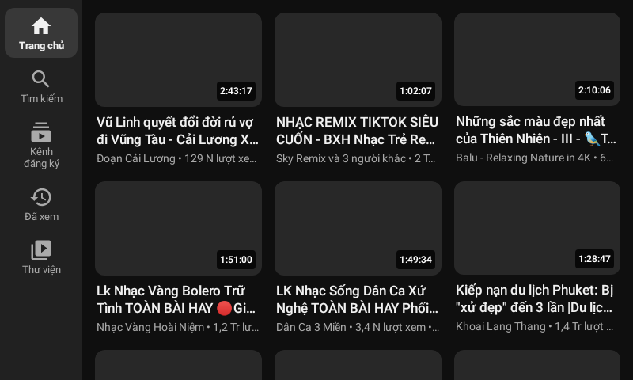
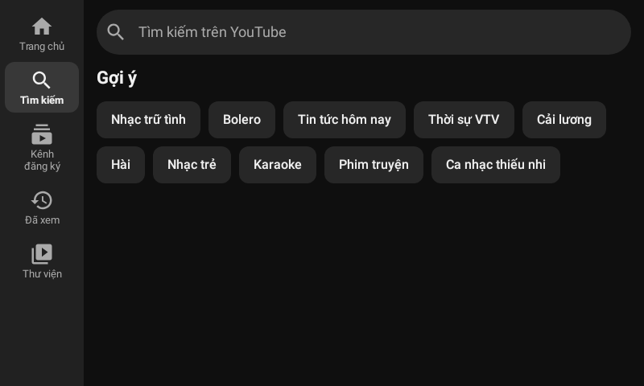
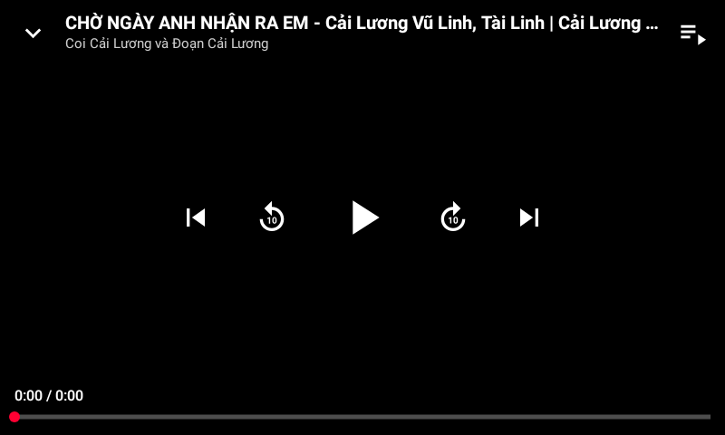

# Tube Sạch – xem YouTube không quảng cáo

Ứng dụng Android có giao diện theo kiểu app YouTube, **không quảng cáo, không cần đăng nhập**, có hình trong hình, phát khi tắt màn hình và SponsorBlock. Toàn bộ nội dung bằng tiếng Việt: trang chủ, đề xuất, thịnh hành, bình luận, phụ đề.

| Trang chủ | Xem video | Toàn màn hình |
|---|---|---|
|  |  |  |

| Lần đầu mở | Giao diện tối | Trình phát mini | Tìm kiếm | Bạn |
|---|---|---|---|---|
|  |  |  |  |  |

> Ảnh được chụp tự động trên máy tính (Robolectric) với dữ liệu YouTube thật, nên ô ảnh thu nhỏ để trống. Trên điện thoại ảnh hiện bình thường.

## Tính năng

**Giống app YouTube**
- Thanh dưới: *Trang chủ · Shorts · Kênh đăng ký · Bạn*.
- Trang chủ có hàng chip của YouTube (*Tất cả, Âm nhạc, Tin tức, Trò chơi, Danh sách kết hợp, Trực tiếp, Mới tải lên gần đây…*), kệ Shorts, kệ "Tin nổi bật". Kéo xuống để làm mới, cuộn mãi không hết.
- Trang xem có tiêu đề, "…thêm" (nội dung mô tả: link và mốc thời gian bấm được), kênh kèm nút **Đăng ký** / **🔔 Đã đăng ký ⌄**, viên 👍 | 👎, Chia sẻ, Lưu, thẻ Bình luận, video liên quan.
- Trình phát có:
  - nút ⌄ thu nhỏ, phụ đề CC, ⚙ cài đặt;
  - nút trước / phát / tiếp theo;
  - thanh tua đỏ, chạm 2 lần để tua ±10 giây;
  - vuốt xuống để thu nhỏ, vuốt lên để toàn màn hình.
- Toàn màn hình ngang có tiêu đề, hàng nút Thích / Không thích / Bình luận / Lưu / Chia sẻ.
- Bảng ⚙ giống YouTube:
  - **Chất lượng**: Tự động (khuyên dùng) / Chất lượng hình ảnh cao hơn / Tiết kiệm dữ liệu / Nâng cao (1080p…144p);
  - **Phụ đề**, có *Tự động dịch: Tiếng Việt*;
  - **Tốc độ phát** 0,25–2x;
  - **Hẹn giờ ngủ**;
  - **Lặp lại video**;
  - **SponsorBlock**.
- Trình phát mini nằm trên thanh dưới; giao diện sáng/tối theo máy.
- Trang kênh (ảnh bìa, @tên, số người đăng ký, tab Video / Trực tiếp), tab Shorts vuốt dọc, tab Bạn (video đã xem, đã thích, xem sau).

**Hơn app YouTube (học từ ReVanced / RVX "YT Extended")**
- Không quảng cáo.
- Phát khi tắt màn hình (có nút trên màn hình khoá); lúc đó chỉ tải tiếng để tiết kiệm 4G.
- Hình trong hình tự bật khi bấm nút Home.
- **SponsorBlock**: tự bỏ qua đoạn tài trợ, chọn được từng loại (tài trợ, tự quảng cáo, nhắc đăng ký, mở đầu, kết thúc…). Đoạn được tô màu trên thanh tua, có thông báo "Đã bỏ qua… · Hoàn tác". **Bật/tắt bất cứ lúc nào** bằng nút $ trên trình phát, trong bảng ⚙ hoặc trong Cài đặt.
- **Return YouTube Dislike**: hiện lại số lượt không thích.
- Ẩn Shorts; cỡ chữ lớn cho người lớn tuổi.
- Mở link YouTube được chia sẻ từ Zalo/Facebook; tự kiểm tra bản cập nhật.
- **Dùng trên ô tô (Android Auto)**: xem video có hình khi đỗ xe, nghe tiếng và chọn video khi đang chạy. Xem [hướng dẫn](#dùng-trên-ô-tô-android-auto).

## Đề xuất tiếng Việt mà không cần đăng nhập

Giống YouTube thật: **lần đầu mở, trang chủ trống** ("Thử tìm kiếm để bắt đầu"); app hiện tạm danh sách *Thịnh hành tại Việt Nam* bên dưới. Sau khi xem vài video, trang chủ có đề xuất tiếng Việt của chính YouTube.

Cách làm: giống trình duyệt chưa đăng nhập. App giữ một **mã khách ẩn danh** (visitor ID) và báo cho YouTube biết đã xem video nào. YouTube dựa vào đó để đề xuất. Không có tài khoản Google, không có tên hay email nào. Có thể tắt hoặc xoá trong *Cài đặt → Quyền riêng tư*.

## Đã tìm hiểu những mã nguồn nào?

| Dự án | Sao GitHub | Cách lấy dữ liệu | Nhận xét |
|---|---|---|---|
| NewPipe | ~40,4 nghìn | NewPipeExtractor (Java) | Thư viện lấy dữ liệu tốt nhất, được bảo trì đều; giao diện riêng thì cũ |
| SmartTube | ~35,9 nghìn | MediaServiceCore: gọi thẳng InnerTube | Dành cho TV; ý tưởng gọi thẳng API của YouTube rất nhanh |
| LibreTube | ~12,5 nghìn | Máy chủ Piped hoặc NewPipeExtractor | Giao diện Material |
| ReVanced / RVX (anddea) | – | Sửa (patch) app YouTube gốc | Giao diện YouTube thật nhưng phải tự vá APK của Google, cần GmsCore |
| yt-dlp | rất nhiều | Python | Hợp cho tải video, không hợp làm app xem trên Android |

**Kết hợp trong Tube Sạch:**
- **Gọi thẳng InnerTube** như SmartTube cho trang chủ, tìm kiếm, trang xem, kênh và Shorts. Cách này giữ nguyên chữ tiếng Việt của YouTube ("1,2 Tr lượt xem", "4 ngày trước"), có ảnh đại diện kênh và chip.
- **Lấy link phát bằng máy khách visionOS**: chỉ 1 yêu cầu, khoảng 0,2–0,5 giây; NewPipe cần 1,4–3 giây. App tự dựng manifest DASH nhiều độ phân giải để ExoPlayer tự đổi chất lượng như YouTube.
- **NewPipeExtractor làm dự phòng** khi YouTube đổi cách hoạt động, và để đọc bình luận, gợi ý tìm kiếm.
- **Tính năng của ReVanced/RVX**: SponsorBlock, Return YouTube Dislike, ẩn Shorts, tự chọn chất lượng, hình trong hình, phát nền. Ở đây chúng được làm lại trên app riêng, không sửa APK của Google.

Tên và logo của app được giữ riêng (không dùng logo YouTube) để tránh vi phạm nhãn hiệu, và để Play Protect không cảnh báo "app giả mạo".

## Cài đặt lên điện thoại

1. Vào **Releases** của repo (hoặc *Actions → lần chạy mới nhất → Artifacts*), tải file `TubeSach-2.0.x.apk`.
2. Mở file, cho phép cài từ nguồn này nếu được hỏi, rồi bấm **Cài đặt**. Bản mới cài đè lên bản cũ, không mất lịch sử.

Yêu cầu Android 6.0 trở lên; hình trong hình cần Android 8.0 trở lên.

Một số máy (Xiaomi, Oppo, Vivo, Samsung) có chế độ tiết kiệm pin quá mạnh, làm mất tiếng khi tắt màn hình. Khi đó vào *Cài đặt → Pin → Tube Sạch → Không giới hạn*.

## Dùng trên ô tô (Android Auto)

Cắm điện thoại vào xe (hoặc kết nối Android Auto không dây), Tube Sạch hiện trên màn hình xe theo **2 cách**:

| | Xem video có hình | Nghe tiếng + chọn video |
|---|---|---|
| Khi nào | **Xe đang đỗ** | Mọi lúc, kể cả khi đang chạy |
| Điện thoại cần | Android **15** trở lên | Mọi máy chạy được Android Auto |
| Mở ở đâu | Danh sách ứng dụng của Android Auto → **Tube Sạch** | Danh sách ứng dụng → Tube Sạch (biểu tượng nghe nhạc) |
| Có gì | Giống YouTube: Trang chủ, Tìm kiếm (gõ chữ, bấm micro để nói, hoặc bấm chủ đề gợi ý), Kênh đăng ký, Đã xem (xem tiếp chỗ đang dở), Thư viện (Xem sau, Đã thích, Thịnh hành, Nhạc hàng đầu). Video to, nút to, chạm 2 lần để tua ±10 giây, cột "Video tiếp theo" | Các mục Trang chủ / Kênh đăng ký / Đã xem / Thư viện có ảnh thu nhỏ, ô tìm kiếm, "Ok Google, mở *nhạc bolero* trên Tube Sạch", nút lùi/tới 10 giây và video tiếp theo |

Không có quảng cáo ở cả hai cách. Lịch sử, kênh đăng ký và danh sách Xem sau dùng chung với điện thoại.

| Trang chủ trên xe | Tìm kiếm | Xem video |
|---|---|---|
|  |  |  |

**Vì sao xe chạy thì chỉ có tiếng?** Đây là quy định an toàn của Android Auto: khi xe chuyển bánh, Android Auto tự đóng màn hình xem video. Video vẫn phát tiếp bằng âm thanh, điều khiển được bằng nút trên vô lăng hoặc giọng nói; xe dừng hẳn thì mở lại Tube Sạch để xem tiếp có hình. App không lách quy định này. Người lái xe đừng xem video khi đang lái.

### Cài lên xe (làm một lần trên điện thoại)

Android Auto chỉ hiện ứng dụng tải từ CH Play. Tube Sạch được cài bằng file APK nên phải bật một tuỳ chọn ẩn:

1. Cài Tube Sạch như bình thường (xem phần trên).
2. Mở **Cài đặt Android Auto**: Cài đặt điện thoại → Ứng dụng → Android Auto → *Cài đặt bổ sung trong ứng dụng*. Trên một số máy có thể mở thẳng app Android Auto.
3. Kéo xuống dưới cùng, bấm **Phiên bản** (*Version and permission info*) **10 lần** liền, rồi bấm **OK** ở câu hỏi "Cho phép cài đặt dành cho nhà phát triển?".
4. Bấm nút **⋮** góc trên bên phải → **Cài đặt dành cho nhà phát triển** (*Developer settings*) → bật **Nguồn không xác định** (*Unknown sources*).
5. Rút cáp ra cắm lại (hoặc tắt/bật kết nối xe). Trên màn hình xe, bấm biểu tượng ô vuông (danh sách ứng dụng) → **Tube Sạch**.
6. Nếu chưa thấy: trong Cài đặt Android Auto → **Tuỳ chỉnh trình chạy** (*Customize launcher*) → đánh dấu Tube Sạch.

Khi cập nhật Android Auto, tuỳ chọn ở bước 4 đôi khi tự tắt; làm lại bước 2–4 là được.

**Vẫn không hiện?** Một số máy (Xiaomi, Oppo, Vivo…) hoặc bản Android Auto mới chặn chặt hơn. Khi đó cài lại Tube Sạch từ máy tính để Android Auto coi như cài từ CH Play (không mất dữ liệu):

1. Trên điện thoại bật *Tuỳ chọn nhà phát triển → Gỡ lỗi USB*, cắm vào máy tính có [Android platform-tools](https://developer.android.com/tools/releases/platform-tools).
2. Chạy lệnh (đổi tên file cho đúng bản đã tải):

```bash
adb install -r -i com.android.vending TubeSach-2.0.x.apk
```

**Ghi chú**
- Muốn xem có hình trên xe cần điện thoại Android 15 trở lên: Android Auto chỉ cho phép ứng dụng chạy trên màn hình xe khi đỗ từ Android 15. Máy cũ hơn vẫn dùng được cách "nghe tiếng + chọn video".
- Để Android Auto cho chạy khi đỗ xe, Tube Sạch tự khai là ứng dụng thuộc nhóm "trò chơi" (đây là nhóm duy nhất Android Auto cho phép). Vì vậy một số máy (ví dụ Samsung *Game Launcher*) có thể xếp Tube Sạch vào mục Trò chơi. Không ảnh hưởng gì.
- Bấm nút micro trên màn hình xe lần đầu, điện thoại sẽ hỏi quyền micro: chấp nhận trên **điện thoại**.
- Màn hình xe luôn dùng giao diện tối. Cỡ chữ theo *Cài đặt → Cỡ chữ* trong app.

**Đã tìm hiểu:** [tài liệu Android for Cars](https://developer.android.com/training/cars/parked/auto) (ứng dụng khi đỗ xe, mục Media), [Fermata Auto](https://github.com/AndreyPavlenko/Fermata) và [AndroidAutoMaker](https://github.com/malebuffy/AndroidAutoMaker). Hai dự án này chiếu video kể cả khi xe chạy bằng cách giả làm ứng dụng bản đồ hoặc chiếu lại cả màn hình điện thoại, phải cài qua máy tính và có thể hỏng sau mỗi lần Android Auto cập nhật. Tube Sạch chỉ dùng hai cách chính thức ở trên.

## Khi YouTube thay đổi làm app lỗi

- Đường phát chính (visionOS) lỗi thì app **tự chuyển sang NewPipeExtractor**.
- Muốn cập nhật thư viện: sửa phiên bản `NewPipeExtractor` trong `app/build.gradle.kts` (xem bản mới tại https://github.com/TeamNewPipe/NewPipeExtractor/releases) rồi push lên `main`. GitHub Actions sẽ tự build APK mới.
- Phần đọc giao diện YouTube nằm trong `innertube/Parser.kt`. Test `ParserTest` chạy với dữ liệu thật đã lưu ở `app/src/test/resources/fixtures`.

## Build và test

```bash
./gradlew :app:assembleRelease                                     # APK ở app/build/outputs/apk/release/
./gradlew :app:testDebugUnitTest                                   # test logic, bộ đọc, mở app
./gradlew :app:testDebugUnitTest -Donline=true --tests '*Online*'  # gọi YouTube thật: ExoPlayer đọc hình + tiếng + phụ đề
./gradlew :app:testDebugUnitTest -Dscreenshots=true --tests '*ScreenshotTest*'  # chụp lại ảnh màn hình (cả màn hình ô tô)
```

APK được ký bằng khoá cố định `app/signing/tubesach.jks` để bản cập nhật cài đè được. Nếu repo để công khai, nên tạo khoá riêng: tạo bằng `keytool`, đổi sang base64, rồi lưu vào các secret `SIGNING_KEYSTORE_BASE64`, `SIGNING_STORE_PASSWORD`, `SIGNING_KEY_ALIAS`, `SIGNING_KEY_PASSWORD`. Làm việc này **trước khi** cài cho mọi người.

## Cấu trúc mã

```
app/src/main/java/com/luzart/tubesach/
├── innertube/      InnerTube.kt (gọi API), Parser.kt (đọc trang chủ/tìm kiếm/trang xem/kênh/Shorts),
│                   DirectStreams.kt (link phát + DASH + phụ đề), WatchTracker.kt (báo lượt xem ẩn danh)
├── sponsor/        SponsorBlock + Return YouTube Dislike
├── data/           YouTubeRepository (gộp nguồn + dự phòng NewPipe), LocalStore (lịch sử, kênh đăng ký, cài đặt)
├── player/         PlaybackController (chất lượng, tốc độ, lặp, phụ đề, SponsorBlock, hẹn giờ),
│                   PlaybackService (phát nền + thư viện cho Android Auto), SessionPlayer (nhận lệnh phát từ xe)
├── auto/           CarLibrary (các mục trên màn hình xe, tìm kiếm, giọng nói), ArtworkProvider (ảnh thu nhỏ cho xe)
├── car/            CarActivity + CarScreens (giao diện xem video trên màn hình ô tô khi đỗ xe)
└── ui/             TubeApp (khung chính), screens/ (Trang chủ, Shorts, Kênh đăng ký, Bạn, Tìm kiếm, Kênh, Xem, Cài đặt),
                    player/ (lớp điều khiển, thanh tua, bảng ⚙, trình phát mini), theme/ (màu sáng/tối)
```

## Lưu ý

- Dùng cho mục đích cá nhân. Xem YouTube qua ứng dụng bên thứ ba không đúng Điều khoản dịch vụ của YouTube. App không liên kết với YouTube hay Google.
- Video giới hạn độ tuổi, video riêng tư và video chỉ dành cho hội viên không xem được vì cần đăng nhập.
- Hãy ủng hộ người làm video bạn yêu thích.

## Giấy phép

GPL-3.0 (theo [NewPipeExtractor](https://github.com/TeamNewPipe/NewPipeExtractor)). Có tham khảo [NewPipe](https://github.com/TeamNewPipe/NewPipe), [SmartTube](https://github.com/yuliskov/SmartTube), [SponsorBlock](https://sponsor.ajay.app), [Return YouTube Dislike](https://returnyoutubedislike.com).
