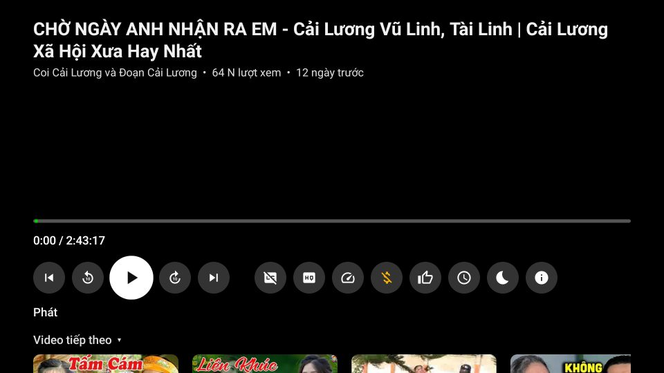
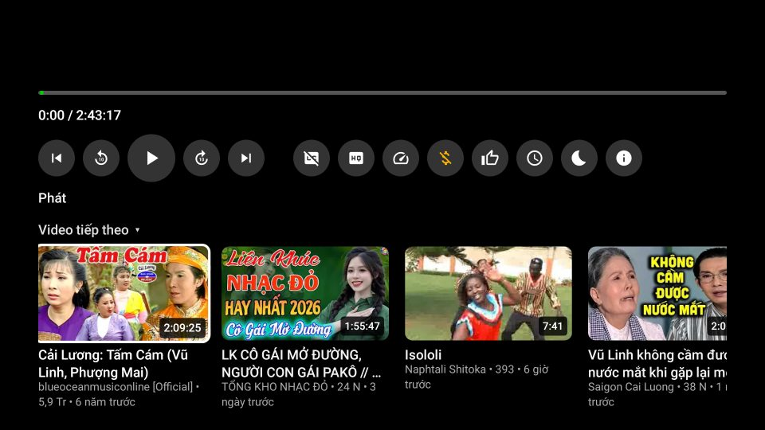
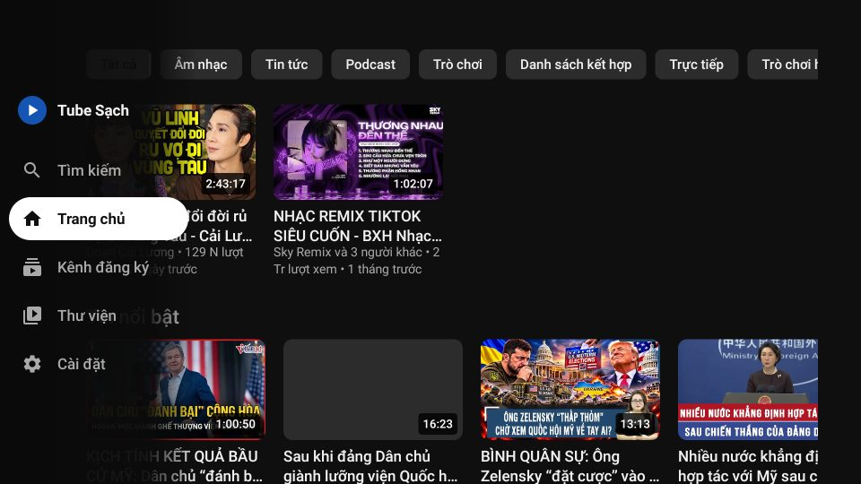
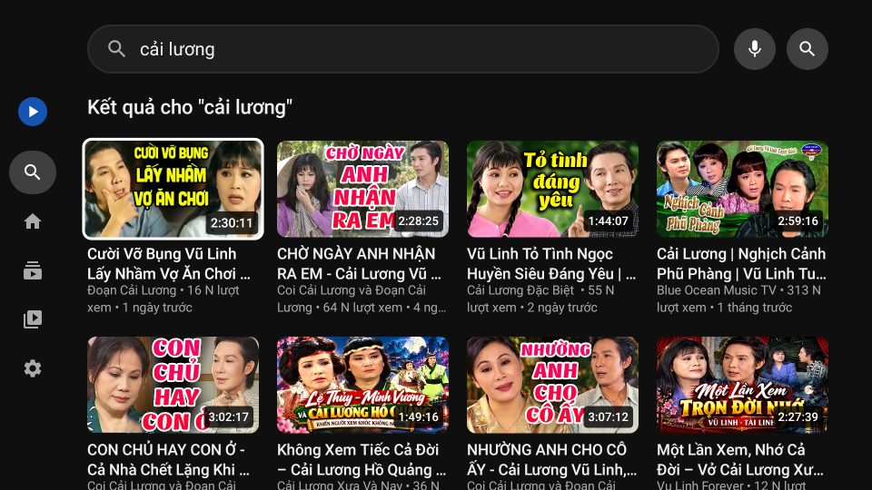
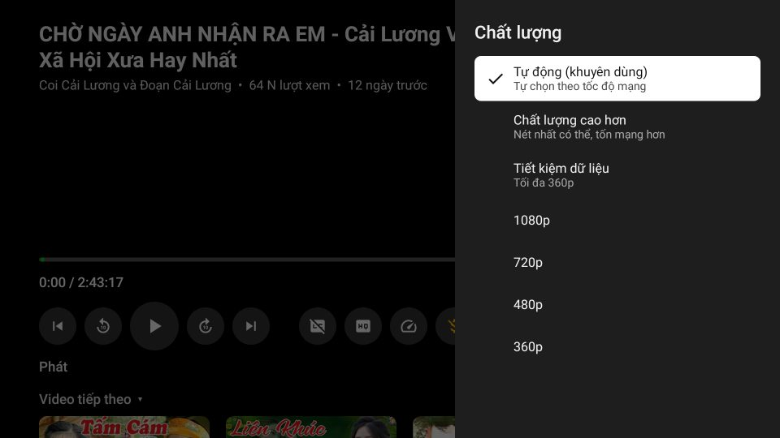
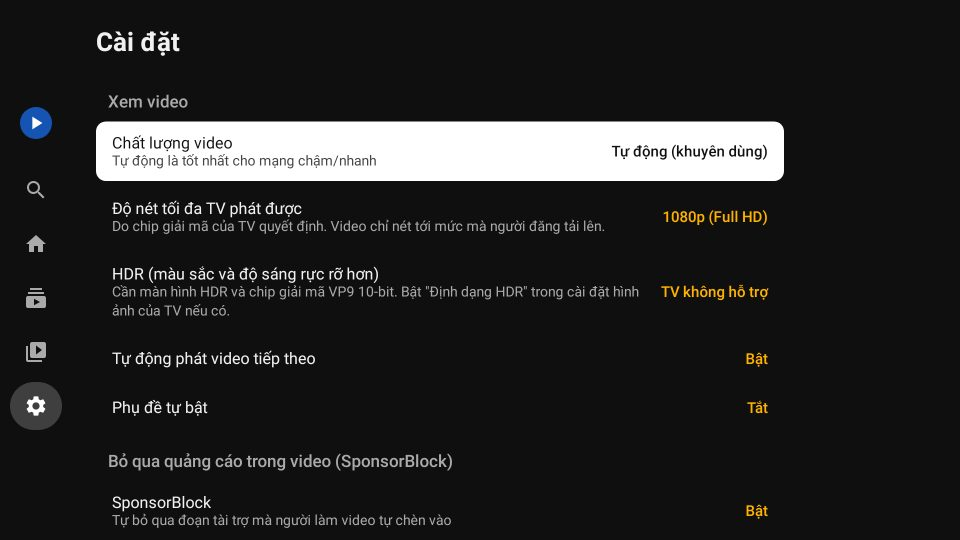

# Tube Sạch – xem YouTube không quảng cáo

Ứng dụng Android có giao diện theo kiểu app YouTube, **không quảng cáo, không cần đăng nhập**, có hình trong hình, phát khi tắt màn hình và SponsorBlock. Toàn bộ nội dung bằng tiếng Việt: trang chủ, đề xuất, thịnh hành, bình luận, phụ đề.

| Trang chủ | Xem video | Toàn màn hình |
|---|---|---|
|  |  |  |

| Lần đầu mở | Giao diện tối | Trình phát mini | Tìm kiếm | Bạn |
|---|---|---|---|---|
|  |  |  |  |  |

> Ảnh được chụp tự động trên máy tính (Robolectric) với dữ liệu YouTube thật, nên ô ảnh thu nhỏ để trống. Trên điện thoại ảnh hiện bình thường.

## Có cả bản cho TV: Tube Sạch TV 📺

Bản dành riêng cho **Google TV / Android TV**, ví dụ TV Coocaa 55Y73. Điều khiển hoàn toàn bằng remote: chọn bằng ◀ ▶ ▲ ▼ rồi bấm OK. Chữ to, nhìn rõ từ xa. Không quảng cáo, không cần đăng nhập.

👉 **[Hướng dẫn cài lên TV từng bước](docs/HUONG_DAN_CAI_TV.md)**

| Trang chủ | Xem video | Video tiếp theo |
|---|---|---|
|  |  |  |

| Thanh bên trái | Tìm kiếm | Chất lượng | Cài đặt |
|---|---|---|---|
|  |  |  |  |

**Có gì trên bản TV**
- Thanh bên trái kiểu YouTube trên TV: *Tìm kiếm · Trang chủ · Kênh đăng ký · Thư viện · Cài đặt*. Trang chủ có đề xuất tiếng Việt, hàng chip, kệ Shorts và tin nổi bật, cuộn mãi không hết.
- Trình phát toàn màn hình:
  - **OK** = tạm dừng / phát; **◀ ▶** = lùi / tua 10 giây. Bấm nhiều lần sẽ được gộp thành một lần tua; giữ phím để tua nhanh hơn.
  - **▲ ▼** = hiện nút điều khiển, có chữ giải thích cho từng nút; **▼** thêm lần nữa để xem *Video tiếp theo*.
  - Nhận cả phím ⏯ ⏪ ⏩ ⏭ của remote, tai nghe Bluetooth và Google Assistant.
- Phụ đề (có *Tự động dịch: Tiếng Việt*), chất lượng (Tự động / 1080p…360p), tốc độ phát, **hẹn giờ tắt** (cho người hay ngủ quên khi xem), thích, xem sau, đăng ký kênh.
- **SponsorBlock** (tự bỏ qua đoạn tài trợ, có tô màu trên thanh tua) và **Return YouTube Dislike**: dùng chung phần lõi với bản điện thoại.
- **Giữ OK** trên một video để mở menu: *Xem sau*, *Đi đến kênh*, *Phát từ đầu*, *Không quan tâm*.
- Thoát video là ô sáng quay lại đúng video vừa xem. Nút Quay lại hoạt động như YouTube trên TV. Rời app (nút Home) thì video tạm dừng, vị trí xem được lưu lại.
- **Nét tới 2K / 4K / 8K** (tuỳ video): app kiểm tra chip giải mã của TV rồi phát luồng VP9 của YouTube tới mức cao nhất mà phần cứng làm được. TV không hỗ trợ thì tự dùng H.264 1080p. Có **HDR10 / HLG** khi video được quay HDR và cả màn hình lẫn chip giải mã của TV đều hỗ trợ (bật/tắt trong Cài đặt).
- Nhẹ cho TV yếu (RAM 2 GB): APK khoảng 4 MB, giới hạn bộ nhớ ảnh.
- Tự tải và cài bản cập nhật ngay trên TV, vì TV thường không có trình duyệt. Tính năng này chỉ chạy khi repo để công khai.
- Cài song song với app điện thoại được, vì là gói riêng `com.luzart.tubesach.tv`.

## Tính năng

**Giống app YouTube**
- Thanh dưới: *Trang chủ · Shorts · Kênh đăng ký · Bạn*.
- Trang chủ có hàng chip của YouTube (*Tất cả, Âm nhạc, Tin tức, Trò chơi, Danh sách kết hợp, Trực tiếp, Mới tải lên gần đây…*), kệ Shorts, kệ "Tin nổi bật". Kéo xuống để làm mới, cuộn mãi không hết.
- Trang xem có tiêu đề, "…thêm" (nội dung mô tả: link và mốc thời gian bấm được), kênh kèm nút **Đăng ký** / **🔔 Đã đăng ký ⌄**, viên 👍 | 👎, Chia sẻ, Lưu, thẻ Bình luận, video liên quan.
- Trình phát có:
  - nút ⌄ thu nhỏ, phụ đề CC, ⚙ cài đặt;
  - nút trước / phát / tiếp theo;
  - thanh tua đỏ, chạm 2 lần để tua ±10 giây;
  - vuốt xuống để thu nhỏ, vuốt lên để toàn màn hình.
- Toàn màn hình ngang có tiêu đề, hàng nút Thích / Không thích / Bình luận / Lưu / Chia sẻ.
- Bảng ⚙ giống YouTube:
  - **Chất lượng**: Tự động (khuyên dùng) / Chất lượng hình ảnh cao hơn / Tiết kiệm dữ liệu / Nâng cao (1080p…144p);
  - **Phụ đề**, có *Tự động dịch: Tiếng Việt*;
  - **Tốc độ phát** 0,25–2x;
  - **Hẹn giờ ngủ**;
  - **Lặp lại video**;
  - **SponsorBlock**.
- Trình phát mini nằm trên thanh dưới; giao diện sáng/tối theo máy.
- Trang kênh (ảnh bìa, @tên, số người đăng ký, tab Video / Trực tiếp), tab Shorts vuốt dọc, tab Bạn (video đã xem, đã thích, xem sau).

**Hơn app YouTube (học từ ReVanced / RVX "YT Extended")**
- Không quảng cáo.
- Phát khi tắt màn hình (có nút trên màn hình khoá); lúc đó chỉ tải tiếng để tiết kiệm 4G.
- Hình trong hình tự bật khi bấm nút Home.
- **SponsorBlock**: tự bỏ qua đoạn tài trợ, chọn được từng loại (tài trợ, tự quảng cáo, nhắc đăng ký, mở đầu, kết thúc…). Đoạn được tô màu trên thanh tua, có thông báo "Đã bỏ qua… · Hoàn tác". **Bật/tắt bất cứ lúc nào** bằng nút $ trên trình phát, trong bảng ⚙ hoặc trong Cài đặt.
- **Return YouTube Dislike**: hiện lại số lượt không thích.
- Ẩn Shorts; cỡ chữ lớn cho người lớn tuổi.
- Mở link YouTube được chia sẻ từ Zalo/Facebook; tự kiểm tra bản cập nhật.

## Đề xuất tiếng Việt mà không cần đăng nhập

Giống YouTube thật: **lần đầu mở, trang chủ trống** ("Thử tìm kiếm để bắt đầu"); app hiện tạm danh sách *Thịnh hành tại Việt Nam* bên dưới. Sau khi xem vài video, trang chủ có đề xuất tiếng Việt của chính YouTube.

Cách làm: giống trình duyệt chưa đăng nhập. App giữ một **mã khách ẩn danh** (visitor ID) và báo cho YouTube biết đã xem video nào. YouTube dựa vào đó để đề xuất. Không có tài khoản Google, không có tên hay email nào. Có thể tắt hoặc xoá trong *Cài đặt → Quyền riêng tư*.

## Đã tìm hiểu những mã nguồn nào?

| Dự án | Sao GitHub | Cách lấy dữ liệu | Nhận xét |
|---|---|---|---|
| NewPipe | ~40,4 nghìn | NewPipeExtractor (Java) | Thư viện lấy dữ liệu tốt nhất, được bảo trì đều; giao diện riêng thì cũ |
| SmartTube | ~35,9 nghìn | MediaServiceCore: gọi thẳng InnerTube | Dành cho TV; ý tưởng gọi thẳng API của YouTube rất nhanh |
| LibreTube | ~12,5 nghìn | Máy chủ Piped hoặc NewPipeExtractor | Giao diện Material |
| ReVanced / RVX (anddea) | – | Sửa (patch) app YouTube gốc | Giao diện YouTube thật nhưng phải tự vá APK của Google, cần GmsCore |
| yt-dlp | rất nhiều | Python | Hợp cho tải video, không hợp làm app xem trên Android |

**Kết hợp trong Tube Sạch:**
- **Gọi thẳng InnerTube** như SmartTube cho trang chủ, tìm kiếm, trang xem, kênh và Shorts. Cách này giữ nguyên chữ tiếng Việt của YouTube ("1,2 Tr lượt xem", "4 ngày trước"), có ảnh đại diện kênh và chip.
- **Lấy link phát bằng máy khách visionOS**: chỉ 1 yêu cầu, khoảng 0,2–0,5 giây; NewPipe cần 1,4–3 giây. App tự dựng manifest DASH nhiều độ phân giải để ExoPlayer tự đổi chất lượng như YouTube.
- **NewPipeExtractor làm dự phòng** khi YouTube đổi cách hoạt động, và để đọc bình luận, gợi ý tìm kiếm.
- **Tính năng của ReVanced/RVX**: SponsorBlock, Return YouTube Dislike, ẩn Shorts, tự chọn chất lượng, hình trong hình, phát nền. Ở đây chúng được làm lại trên app riêng, không sửa APK của Google.
- **Bản TV:**
  - Học cách điều khiển của SmartTube và YouTube trên TV: thanh bên trái, ◀ ▶ để tua khi đang xem, ▼ để xem video tiếp theo, giữ OK để mở menu, hẹn giờ tắt.
  - Giao diện viết lại bằng Jetpack Compose. Compose tự cuộn để ô đang chọn luôn nằm ở vị trí dễ nhìn trên TV.
  - Phần lấy dữ liệu và trình phát dùng chung với bản điện thoại (module `core`), nên khi YouTube thay đổi chỉ cần sửa một chỗ.

Tên và logo của app được giữ riêng (không dùng logo YouTube) để tránh vi phạm nhãn hiệu, và để Play Protect không cảnh báo "app giả mạo".

## Cài đặt lên TV

Xem **[docs/HUONG_DAN_CAI_TV.md](docs/HUONG_DAN_CAI_TV.md)**: bật chế độ nhà phát triển, gửi file `TubeSachTV-2.0.x.apk` từ điện thoại hoặc USB, cài đặt và cách dùng remote.

## Cài đặt lên điện thoại

1. Vào **Releases** của repo (hoặc *Actions → lần chạy mới nhất → Artifacts*), tải file `TubeSach-2.0.x.apk`.
2. Mở file, cho phép cài từ nguồn này nếu được hỏi, rồi bấm **Cài đặt**. Bản mới cài đè lên bản cũ, không mất lịch sử.

Yêu cầu Android 6.0 trở lên; hình trong hình cần Android 8.0 trở lên.

Một số máy (Xiaomi, Oppo, Vivo, Samsung) có chế độ tiết kiệm pin quá mạnh, làm mất tiếng khi tắt màn hình. Khi đó vào *Cài đặt → Pin → Tube Sạch → Không giới hạn*.

## Khi YouTube thay đổi làm app lỗi

- Đường phát chính (visionOS) lỗi thì app **tự chuyển sang NewPipeExtractor**.
- Muốn cập nhật thư viện: sửa phiên bản `NewPipeExtractor` trong `app/build.gradle.kts` (xem bản mới tại https://github.com/TeamNewPipe/NewPipeExtractor/releases) rồi push lên `main`. GitHub Actions sẽ tự build APK mới.
- Phần đọc giao diện YouTube nằm trong `innertube/Parser.kt`. Test `ParserTest` chạy với dữ liệu thật đã lưu ở `app/src/test/resources/fixtures`.

## Build và test

```bash
./gradlew :app:assembleRelease :tv:assembleRelease                 # APK ở app/… và tv/build/outputs/apk/release/
./gradlew :core:testDebugUnitTest :app:testDebugUnitTest :tv:testDebugUnitTest  # test logic, bộ đọc, mở app, điều khiển bằng remote
./gradlew :app:testDebugUnitTest -Donline=true --tests '*Online*'  # gọi YouTube thật: ExoPlayer đọc hình + tiếng + phụ đề
./gradlew :tv:testDebugUnitTest -Donline=true --tests '*Online*'   # app TV + YouTube thật, chỉ bấm phím remote: trang chủ → xem → video tiếp theo → quay lại → tìm kiếm
./gradlew :app:testDebugUnitTest -Dscreenshots=true --tests '*ScreenshotTest*'  # chụp lại ảnh màn hình điện thoại
./gradlew :tv:testDebugUnitTest -Dscreenshots=true -Donline=true --tests '*TvScreenshotTest*'  # ảnh màn hình TV 1920×1080 (kèm ảnh thu nhỏ thật)
```

Test của app TV (`tv/src/test`) giả lập TV 1920×1080 và **chỉ bấm phím remote**. Các trường hợp được kiểm tra:
- mở app thì ô sáng vào video đầu tiên;
- bấm ◀ thì về đúng mục trên thanh bên trái;
- ô sáng không bị kẹt trong ô tìm kiếm;
- khi đang xem video, ô sáng không lọt ra trang chủ phía sau;
- đóng bảng chọn thì ô sáng về đúng nút vừa bấm;
- thoát video thì về đúng thẻ video;
- thứ tự nút Quay lại, giữ OK mở menu, tua gộp nhiều lần bấm.

APK điện thoại và APK TV đều được ký bằng khoá cố định `app/signing/tubesach.jks` để bản cập nhật cài đè được. Nếu repo để công khai, nên tạo khoá riêng: tạo bằng `keytool`, đổi sang base64, rồi lưu vào các secret `SIGNING_KEYSTORE_BASE64`, `SIGNING_STORE_PASSWORD`, `SIGNING_KEY_ALIAS`, `SIGNING_KEY_PASSWORD`. Làm việc này **trước khi** cài cho mọi người.

## Cấu trúc mã

Gồm 3 module: **`core`** là phần lõi dùng chung (lấy dữ liệu YouTube, trình phát, SponsorBlock, lưu trữ, cập nhật). **`app`** là giao diện điện thoại. **`tv`** là giao diện TV.

```
core/src/main/java/com/luzart/tubesach/
├── innertube/      InnerTube.kt (gọi API), Parser.kt (đọc trang chủ/tìm kiếm/trang xem/kênh/Shorts),
│                   DirectStreams.kt (link phát + DASH + phụ đề), WatchTracker.kt (báo lượt xem ẩn danh)
├── sponsor/        SponsorBlock + Return YouTube Dislike
├── data/           YouTubeRepository (gộp nguồn + dự phòng NewPipe), LocalStore (lịch sử, kênh đăng ký, cài đặt)
├── player/         PlaybackController (chất lượng, tốc độ, lặp, phụ đề, SponsorBlock, hẹn giờ), PlaybackService (phát nền)
└── update/         UpdateChecker (GitHub Releases; mỗi app lấy đúng APK của mình)

app/src/main/java/com/luzart/tubesach/
└── ui/             TubeApp (khung chính), screens/ (Trang chủ, Shorts, Kênh đăng ký, Bạn, Tìm kiếm, Kênh, Xem, Cài đặt),
                    player/ (lớp điều khiển, thanh tua, bảng ⚙, trình phát mini), theme/ (màu sáng/tối)

tv/src/main/java/com/luzart/tubesach/tv/
├── TvActivity, TvApp, TvViewModel   (điều hướng, nút Quay lại, tải dữ liệu)
├── ui/             TvRoot (khung chính, đặt ô sáng), Sidebar, Components (thẻ video, nút, bảng chọn, lưới), Focus (bấm OK / giữ OK)
├── screens/        Trang chủ, Tìm kiếm, Kênh, Kênh đăng ký, Thư viện, Cài đặt, menu video
├── player/         PlayerScreen (trình phát toàn màn hình), PlayerKeys (phím remote, gộp lần tua), PlayerPanels (chất lượng, phụ đề…)
└── update/         TvUpdater (tải APK và mở trình cài đặt ngay trên TV)
```

## Lưu ý

- Dùng cho mục đích cá nhân. Xem YouTube qua ứng dụng bên thứ ba không đúng Điều khoản dịch vụ của YouTube. App không liên kết với YouTube hay Google.
- Video giới hạn độ tuổi, video riêng tư và video chỉ dành cho hội viên không xem được vì cần đăng nhập.
- Hãy ủng hộ người làm video bạn yêu thích.

## Giấy phép

GPL-3.0 (theo [NewPipeExtractor](https://github.com/TeamNewPipe/NewPipeExtractor)). Có tham khảo [NewPipe](https://github.com/TeamNewPipe/NewPipe), [SmartTube](https://github.com/yuliskov/SmartTube), [SponsorBlock](https://sponsor.ajay.app), [Return YouTube Dislike](https://returnyoutubedislike.com).
