# Tube Sạch – xem YouTube không quảng cáo

Ứng dụng Android và **iPhone/iPad** có giao diện theo kiểu app YouTube, **không quảng cáo, không cần đăng nhập**, có hình trong hình, phát khi tắt màn hình và SponsorBlock. Toàn bộ nội dung bằng tiếng Việt: trang chủ, đề xuất, thịnh hành, bình luận, phụ đề.

| Trang chủ | Xem video | Toàn màn hình |
|---|---|---|
| 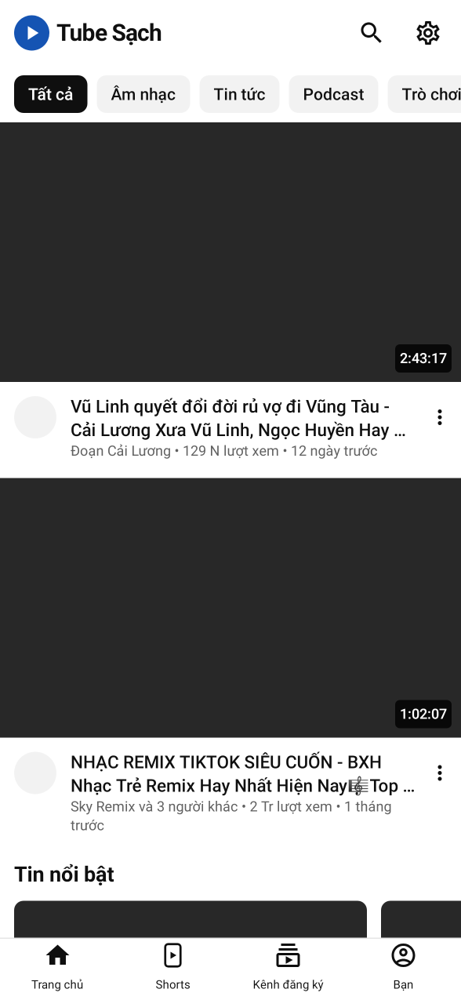 | 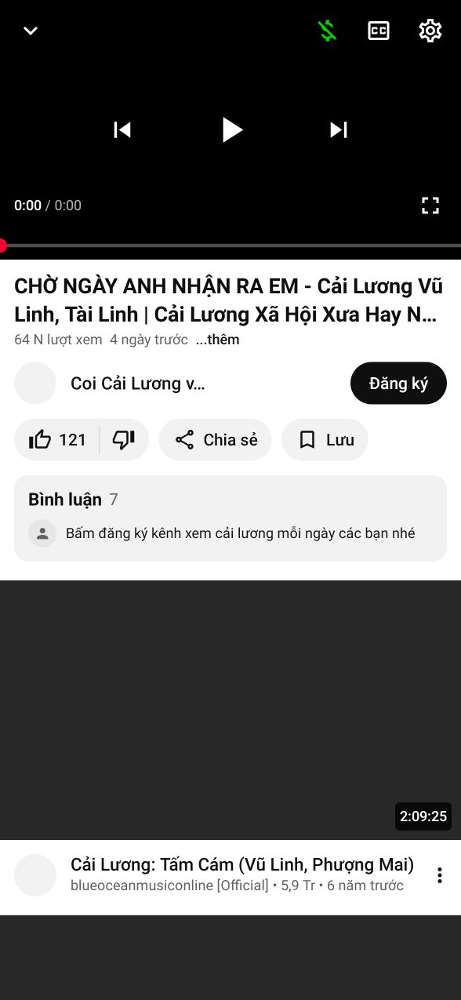 | 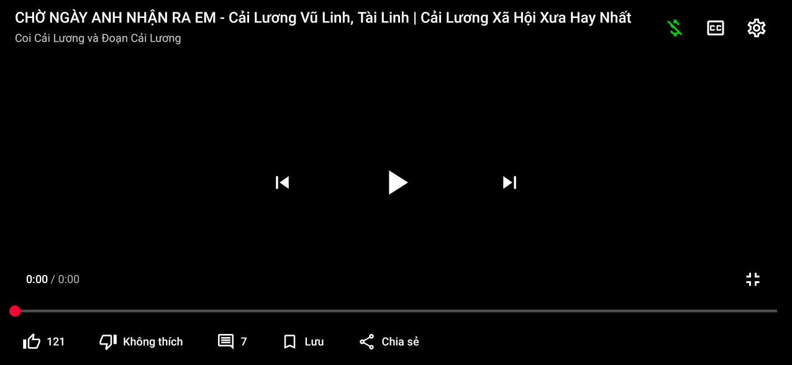 |

| Lần đầu mở | Giao diện tối | Trình phát mini | Tìm kiếm | Bạn |
|---|---|---|---|---|
| 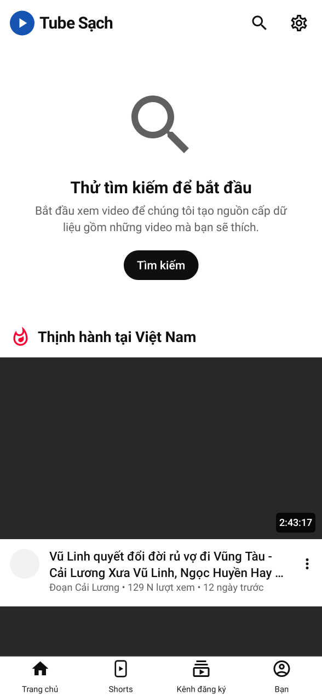 | 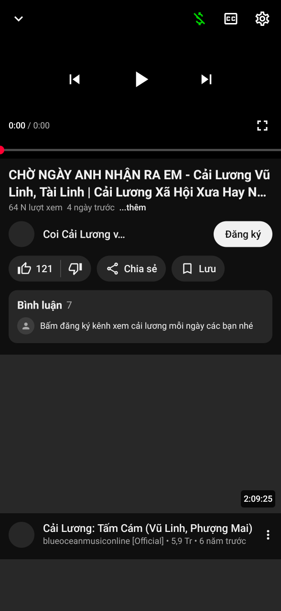 | 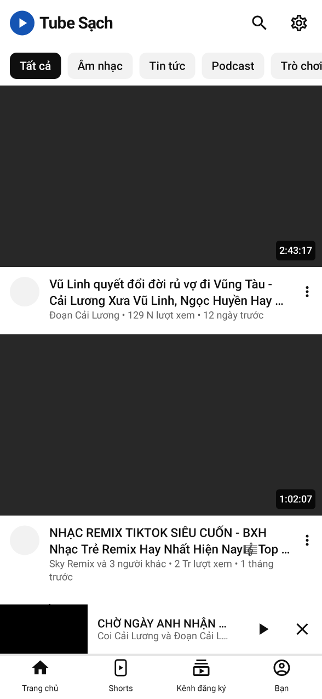 | 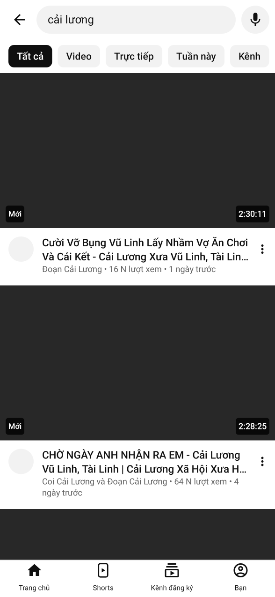 | 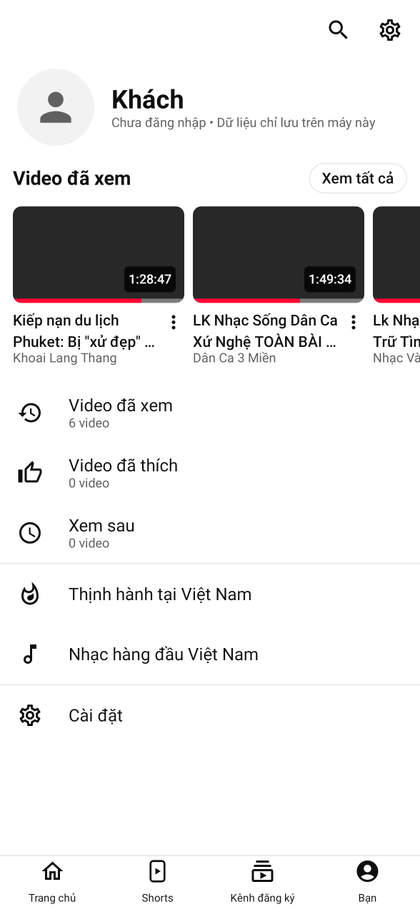 |

> Ảnh được chụp tự động trên máy tính (Robolectric) với dữ liệu YouTube thật, nên ô ảnh thu nhỏ để trống. Trên điện thoại ảnh hiện bình thường.

## Tính năng

**Giống app YouTube**
- Thanh dưới: *Trang chủ · Shorts · Kênh đăng ký · Bạn*.
- Trang chủ có hàng chip của YouTube (*Tất cả, Âm nhạc, Tin tức, Trò chơi, Danh sách kết hợp, Trực tiếp, Mới tải lên gần đây…*), kệ Shorts, kệ "Tin nổi bật". Kéo xuống để làm mới, cuộn mãi không hết.
- Trang xem có tiêu đề, "…thêm" (nội dung mô tả: link và mốc thời gian bấm được), kênh kèm nút **Đăng ký** / **🔔 Đã đăng ký ⌄**, viên 👍 | 👎, Chia sẻ, Lưu, thẻ Bình luận, video liên quan.
- Trình phát có:
  - nút ⌄ thu nhỏ, phụ đề CC, ⚙ cài đặt;
  - nút trước / phát / tiếp theo;
  - thanh tua đỏ, chạm 2 lần để tua ±10 giây;
  - vuốt xuống để thu nhỏ, vuốt lên để toàn màn hình.
- Toàn màn hình ngang có tiêu đề, hàng nút Thích / Không thích / Bình luận / Lưu / Chia sẻ.
- Bảng ⚙ giống YouTube:
  - **Chất lượng**: Tự động (khuyên dùng) / Chất lượng hình ảnh cao hơn / Tiết kiệm dữ liệu / Nâng cao (1080p…144p);
  - **Phụ đề**, có *Tự động dịch: Tiếng Việt*;
  - **Tốc độ phát** 0,25–2x;
  - **Hẹn giờ ngủ**;
  - **Lặp lại video**;
  - **SponsorBlock**.
- Trình phát mini nằm trên thanh dưới; giao diện sáng/tối theo máy.
- Trang kênh (ảnh bìa, @tên, số người đăng ký, tab Video / Trực tiếp), tab Shorts vuốt dọc, tab Bạn (video đã xem, đã thích, xem sau).

**Hơn app YouTube (học từ ReVanced / RVX "YT Extended")**
- Không quảng cáo.
- Phát khi tắt màn hình (có nút trên màn hình khoá); lúc đó chỉ tải tiếng để tiết kiệm 4G.
- Hình trong hình tự bật khi bấm nút Home.
- **SponsorBlock**: tự bỏ qua đoạn tài trợ, chọn được từng loại (tài trợ, tự quảng cáo, nhắc đăng ký, mở đầu, kết thúc…). Đoạn được tô màu trên thanh tua, có thông báo "Đã bỏ qua… · Hoàn tác". **Bật/tắt bất cứ lúc nào** bằng nút $ trên trình phát, trong bảng ⚙ hoặc trong Cài đặt.
- **Return YouTube Dislike**: hiện lại số lượt không thích.
- Ẩn Shorts; cỡ chữ lớn cho người lớn tuổi.
- Mở link YouTube được chia sẻ từ Zalo/Facebook; tự kiểm tra bản cập nhật.

## Đề xuất tiếng Việt mà không cần đăng nhập

Giống YouTube thật: **lần đầu mở, trang chủ trống** ("Thử tìm kiếm để bắt đầu"); app hiện tạm danh sách *Thịnh hành tại Việt Nam* bên dưới. Sau khi xem vài video, trang chủ có đề xuất tiếng Việt của chính YouTube.

Cách làm: giống trình duyệt chưa đăng nhập. App giữ một **mã khách ẩn danh** (visitor ID) và báo cho YouTube biết đã xem video nào. YouTube dựa vào đó để đề xuất. Không có tài khoản Google, không có tên hay email nào. Có thể tắt hoặc xoá trong *Cài đặt → Quyền riêng tư*.

## Đã tìm hiểu những mã nguồn nào?

| Dự án | Sao GitHub | Cách lấy dữ liệu | Nhận xét |
|---|---|---|---|
| NewPipe | ~40,4 nghìn | NewPipeExtractor (Java) | Thư viện lấy dữ liệu tốt nhất, được bảo trì đều; giao diện riêng thì cũ |
| SmartTube | ~35,9 nghìn | MediaServiceCore: gọi thẳng InnerTube | Dành cho TV; ý tưởng gọi thẳng API của YouTube rất nhanh |
| LibreTube | ~12,5 nghìn | Máy chủ Piped hoặc NewPipeExtractor | Giao diện Material |
| ReVanced / RVX (anddea) | – | Sửa (patch) app YouTube gốc | Giao diện YouTube thật nhưng phải tự vá APK của Google, cần GmsCore |
| yt-dlp | rất nhiều | Python | Hợp cho tải video, không hợp làm app xem trên Android |

**Kết hợp trong Tube Sạch:**
- **Gọi thẳng InnerTube** như SmartTube cho trang chủ, tìm kiếm, trang xem, kênh và Shorts. Cách này giữ nguyên chữ tiếng Việt của YouTube ("1,2 Tr lượt xem", "4 ngày trước"), có ảnh đại diện kênh và chip.
- **Lấy link phát bằng máy khách visionOS**: chỉ 1 yêu cầu, khoảng 0,2–0,5 giây; NewPipe cần 1,4–3 giây. App tự dựng manifest DASH nhiều độ phân giải để ExoPlayer tự đổi chất lượng như YouTube.
- **NewPipeExtractor làm dự phòng** khi YouTube đổi cách hoạt động, và để đọc bình luận, gợi ý tìm kiếm.
- **Tính năng của ReVanced/RVX**: SponsorBlock, Return YouTube Dislike, ẩn Shorts, tự chọn chất lượng, hình trong hình, phát nền. Ở đây chúng được làm lại trên app riêng, không sửa APK của Google.

Tên và logo của app được giữ riêng (không dùng logo YouTube) để tránh vi phạm nhãn hiệu, và để Play Protect không cảnh báo "app giả mạo".

## Cài đặt lên điện thoại Android

1. Vào **Releases** của repo (hoặc *Actions → lần chạy mới nhất → Artifacts*), tải file `TubeSach-2.0.x.apk`.
2. Mở file, cho phép cài từ nguồn này nếu được hỏi, rồi bấm **Cài đặt**. Bản mới cài đè lên bản cũ, không mất lịch sử.

Yêu cầu Android 6.0 trở lên; hình trong hình cần Android 8.0 trở lên.

Một số máy (Xiaomi, Oppo, Vivo, Samsung) có chế độ tiết kiệm pin quá mạnh, làm mất tiếng khi tắt màn hình. Khi đó vào *Cài đặt → Pin → Tube Sạch → Không giới hạn*.

## Bản iPhone / iPad (iOS)

Có bản iOS viết bằng SwiftUI trong thư mục `ios/`, dùng cùng cách lấy dữ liệu với bản Android: trang chủ, Shorts, kênh đăng ký, tìm kiếm (có gợi ý, dán link YouTube để mở thẳng), trang xem, bình luận, trang kênh, SponsorBlock, Return YouTube Dislike, cỡ chữ lớn, giao diện sáng/tối.

Trình phát là trình phát gốc của iOS nên có sẵn:

- tự đổi chất lượng theo mạng (luồng HLS của YouTube), phụ đề, chỉnh tốc độ, AirPlay lên TV;
- hình trong hình khi về màn hình chính;
- phát tiếp khi tắt màn hình, có nút điều khiển trên màn hình khoá và tai nghe.

| Trang chủ | Xem video | Tìm kiếm | Kênh | Giao diện tối |
|---|---|---|---|---|
| 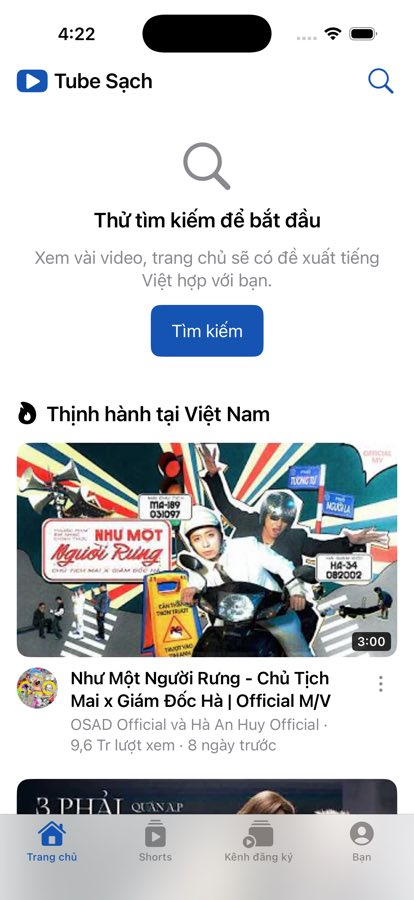 | 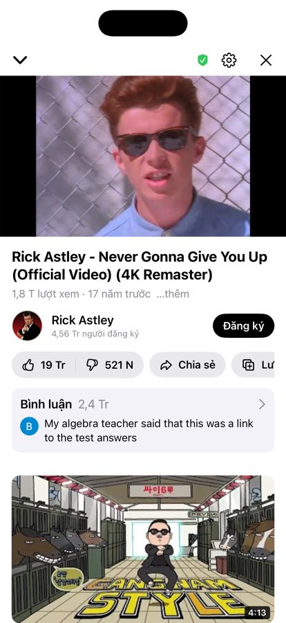 | 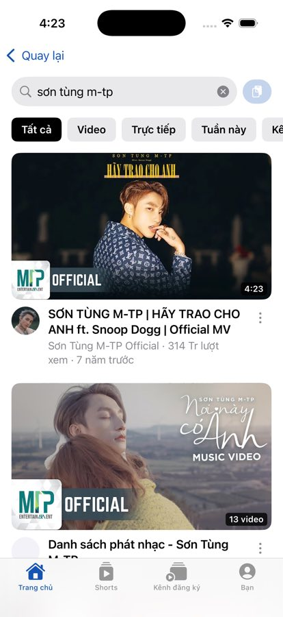 | 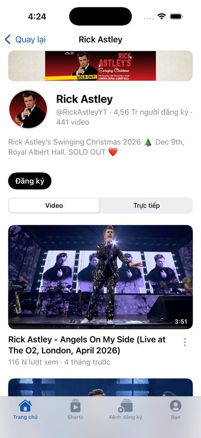 | 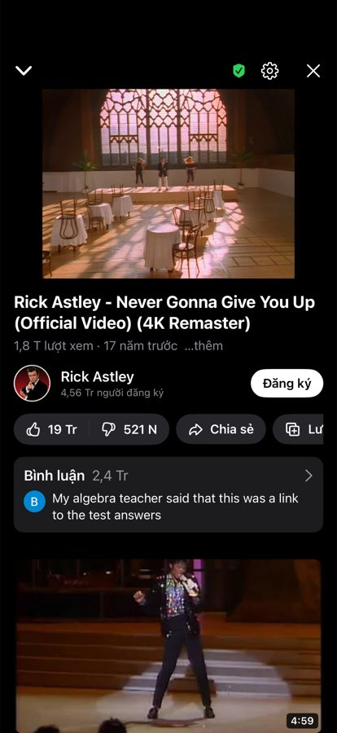 |

| iPad – trang chủ | iPad – xem video | Bạn |
|---|---|---|
| 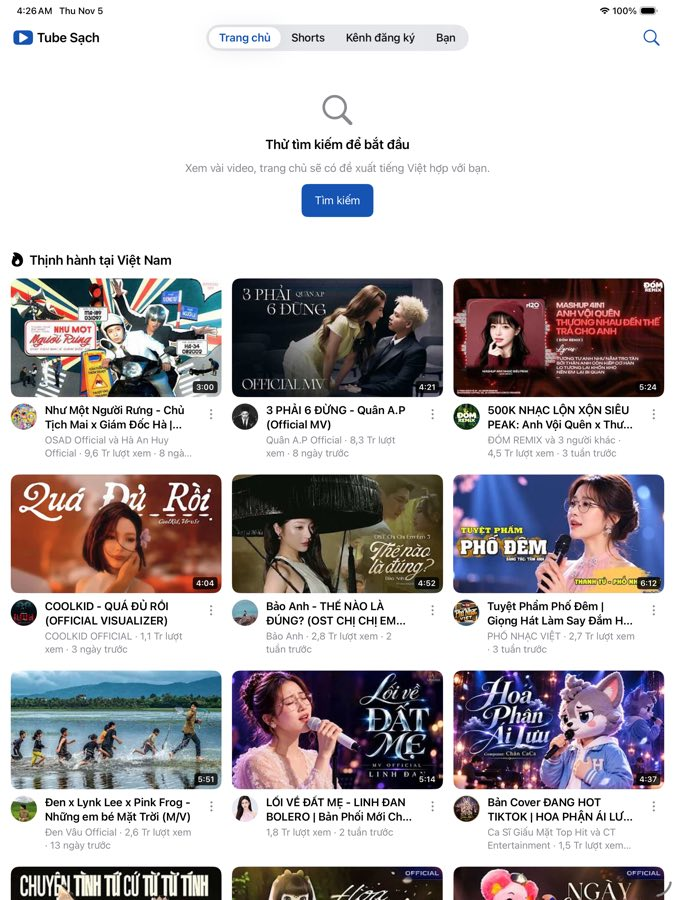 | 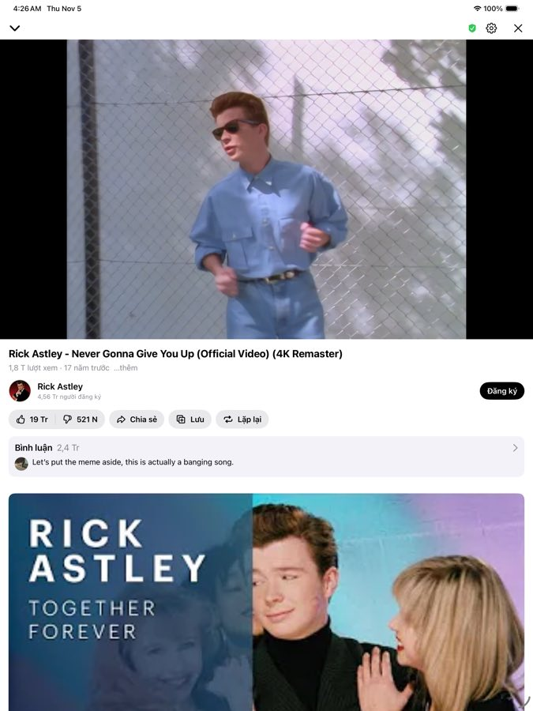 | 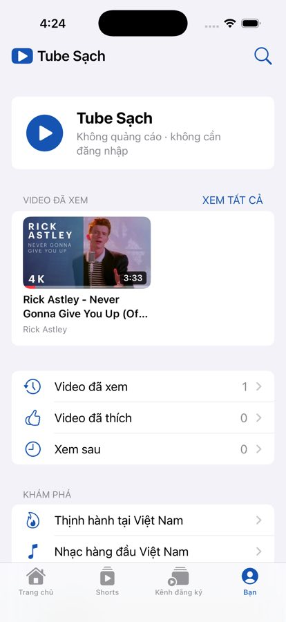 |

> Ảnh chụp tự động trên iPhone 16 và iPad Pro giả lập (GitHub Actions, commit có `[screenshots]`), dữ liệu YouTube thật.

Trên iPad, khi xoay ngang, video liên quan nằm bên phải. Trên iPhone, khi xoay ngang, video tự phóng to hết màn hình. Yêu cầu iOS 16 trở lên (iPhone 8 trở về sau).

### Vì sao không có trên App Store?

Apple không duyệt app xem YouTube chặn quảng cáo, nên phải **tự cài file `.ipa`** (gọi là *sideload*). Mỗi lần đẩy code lên `main`, GitHub Actions tự build file `TubeSach-1.0.x.ipa`:

- vào **Releases**, tìm bản có tên *Tube Sạch iOS 1.0.x*;
- hoặc vào *Actions → Build iOS → lần chạy mới nhất → Artifacts*.

Repo đang để riêng tư nên bạn phải đăng nhập GitHub mới tải được.

File `.ipa` này **chưa ký**. Công cụ cài đặt bên dưới sẽ ký lại bằng Apple ID của bạn.

### Cách 1: Sideloadly (dễ nhất, cần máy tính và cáp)

1. Cài **Sideloadly** (sideloadly.io) trên máy tính Windows hoặc Mac. Trên Windows cần cài thêm iTunes và iCloud **bản tải từ trang Apple** (không dùng bản trong Microsoft Store).
2. Cắm iPhone/iPad vào máy tính, mở khoá máy và bấm **Tin cậy**.
3. Kéo file `TubeSach-1.0.x.ipa` vào Sideloadly, nhập Apple ID rồi bấm **Start**. Nên dùng một Apple ID phụ.
4. Trên iPhone/iPad, vào *Cài đặt → Cài đặt chung → Quản lý VPN & thiết bị*, chọn Apple ID vừa dùng rồi bấm **Tin cậy**.
5. Từ iOS 16, cần bật thêm *Cài đặt → Quyền riêng tư & Bảo mật → Chế độ nhà phát triển*. Máy sẽ khởi động lại và hỏi xác nhận.

Với Apple ID **miễn phí**, app chỉ chạy được **7 ngày**. Hết hạn thì cắm máy và bấm Start lại; lịch sử, kênh đăng ký vẫn còn. Sideloadly có tuỳ chọn tự làm mới qua Wi-Fi khi máy tính đang bật. Mỗi Apple ID miễn phí chỉ cài được tối đa 3 app tự ký trên một máy.

### Cách 2: AltStore hoặc SideStore (tự gia hạn)

- **AltStore** (altstore.io): cài AltServer trên máy tính và AltStore trên iPhone. AltStore tự gia hạn 7 ngày khi iPhone và máy tính dùng chung Wi-Fi.
- **SideStore** (sidestore.io): chỉ cần máy tính ở lần cài đặt đầu tiên, sau đó tự gia hạn ngay trên iPhone. Làm theo hướng dẫn trên trang của SideStore.

Trong AltStore/SideStore, vào tab *My Apps*, bấm **+** rồi chọn file `.ipa`.

### Cách 3: Tài khoản Apple Developer trả phí (99 USD/năm)

Đăng nhập Sideloadly bằng Apple ID đã đăng ký Apple Developer Program. App chạy được **1 năm**, không giới hạn 3 app và không phải gia hạn hằng tuần. Một tài khoản cài được cho tối đa 100 iPhone và 100 iPad mỗi năm. Cách này hợp khi cài cho cả nhà, nhất là cho ông bà, bố mẹ.

Bạn cũng có thể tự build bằng Xcode trên Mac (xem *Build và test*): chọn Apple ID ở *Signing & Capabilities*, cắm máy rồi bấm Run.

### Cập nhật bản iOS

Tải file `.ipa` mới rồi cài lại bằng cùng công cụ, cùng Apple ID. Bản mới cài đè lên bản cũ, không mất dữ liệu.

App iOS không dùng được NewPipeExtractor (thư viện Java). Khi YouTube đổi cách hoạt động, app tự thử máy khách iOS nếu máy khách visionOS lỗi. Nếu vẫn lỗi thì cần sửa `ios/TubeSachCore` rồi cài bản build mới.

## Khi YouTube thay đổi làm app lỗi

- Đường phát chính (visionOS) lỗi thì app **tự chuyển sang NewPipeExtractor**.
- Muốn cập nhật thư viện: sửa phiên bản `NewPipeExtractor` trong `app/build.gradle.kts` (xem bản mới tại https://github.com/TeamNewPipe/NewPipeExtractor/releases) rồi push lên `main`. GitHub Actions sẽ tự build APK mới.
- Phần đọc giao diện YouTube nằm trong `innertube/Parser.kt`. Test `ParserTest` chạy với dữ liệu thật đã lưu ở `app/src/test/resources/fixtures`.

## Build và test

```bash
./gradlew :app:assembleRelease                                     # APK ở app/build/outputs/apk/release/
./gradlew :app:testDebugUnitTest                                   # test logic, bộ đọc, mở app
./gradlew :app:testDebugUnitTest -Donline=true --tests '*Online*'  # gọi YouTube thật: ExoPlayer đọc hình + tiếng + phụ đề
./gradlew :app:testDebugUnitTest -Dscreenshots=true --tests '*ScreenshotTest*'  # chụp lại ảnh màn hình
```

Bản iOS:

```bash
cd ios/TubeSachCore && swift test                                   # test phần lõi (chạy được cả trên Linux)
cd ios/TubeSachCore && ONLINE=1 swift test --filter OnlineTests     # gọi YouTube thật: trang chủ, tìm kiếm, HLS, bình luận, kênh, Shorts
brew install xcodegen && cd ios && xcodegen generate && open TubeSach.xcodeproj   # mở dự án trong Xcode (cần Mac)
```

APK được ký bằng khoá cố định `app/signing/tubesach.jks` để bản cập nhật cài đè được. Nếu repo để công khai, nên tạo khoá riêng: tạo bằng `keytool`, đổi sang base64, rồi lưu vào các secret `SIGNING_KEYSTORE_BASE64`, `SIGNING_STORE_PASSWORD`, `SIGNING_KEY_ALIAS`, `SIGNING_KEY_PASSWORD`. Làm việc này **trước khi** cài cho mọi người.

## Cấu trúc mã

```
app/src/main/java/com/luzart/tubesach/
├── innertube/      InnerTube.kt (gọi API), Parser.kt (đọc trang chủ/tìm kiếm/trang xem/kênh/Shorts),
│                   DirectStreams.kt (link phát + DASH + phụ đề), WatchTracker.kt (báo lượt xem ẩn danh)
├── sponsor/        SponsorBlock + Return YouTube Dislike
├── data/           YouTubeRepository (gộp nguồn + dự phòng NewPipe), LocalStore (lịch sử, kênh đăng ký, cài đặt)
├── player/         PlaybackController (chất lượng, tốc độ, lặp, phụ đề, SponsorBlock, hẹn giờ), PlaybackService (phát nền)
└── ui/             TubeApp (khung chính), screens/ (Trang chủ, Shorts, Kênh đăng ký, Bạn, Tìm kiếm, Kênh, Xem, Cài đặt),
                    player/ (lớp điều khiển, thanh tua, bảng ⚙, trình phát mini), theme/ (màu sáng/tối)
```

Bản iOS:

```
ios/
├── project.yml      cấu hình dự án Xcode (XcodeGen)
├── TubeSachCore/    lõi Swift (build/test được trên Linux): InnerTube, Parser (đọc cả bình luận),
│                    PlayerData (luồng HLS), SponsorBlock, Return YouTube Dislike, kênh đăng ký (RSS + dự phòng InnerTube)
└── TubeSach/        app SwiftUI: AppModel (điều hướng, trang chủ, trang xem, kênh, Shorts),
                     Player/ (AVPlayer: HLS, hình trong hình, phát nền, màn hình khoá), Views/ (các màn hình),
                     Data/ (lưu cài đặt, lịch sử, kênh đăng ký trên máy)
```

## Lưu ý

- Dùng cho mục đích cá nhân. Xem YouTube qua ứng dụng bên thứ ba không đúng Điều khoản dịch vụ của YouTube. App không liên kết với YouTube hay Google.
- Video giới hạn độ tuổi, video riêng tư và video chỉ dành cho hội viên không xem được vì cần đăng nhập.
- Hãy ủng hộ người làm video bạn yêu thích.

## Giấy phép

GPL-3.0 (theo [NewPipeExtractor](https://github.com/TeamNewPipe/NewPipeExtractor)). Có tham khảo [NewPipe](https://github.com/TeamNewPipe/NewPipe), [SmartTube](https://github.com/yuliskov/SmartTube), [SponsorBlock](https://sponsor.ajay.app), [Return YouTube Dislike](https://returnyoutubedislike.com).
