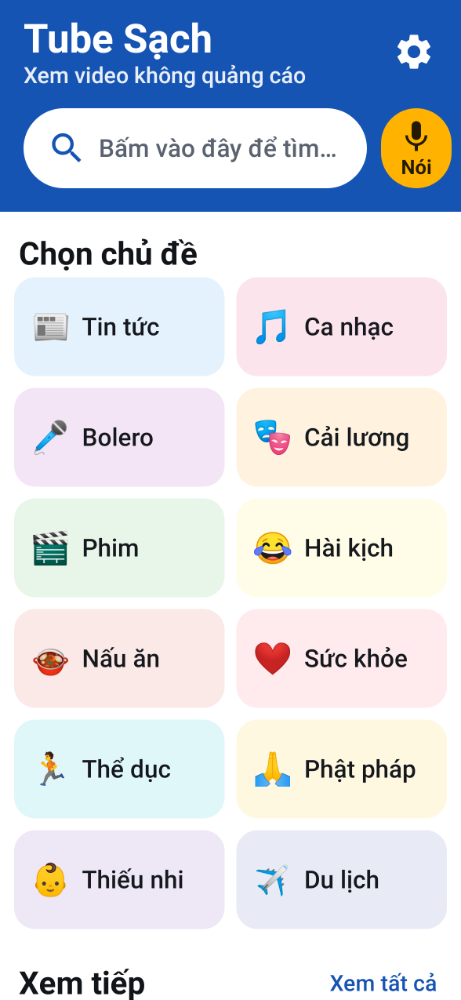
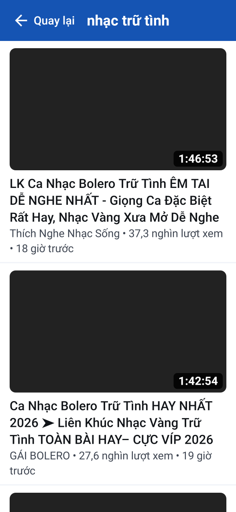
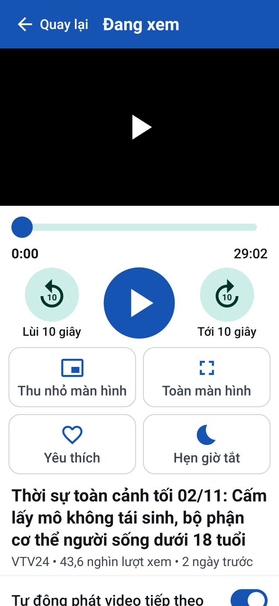
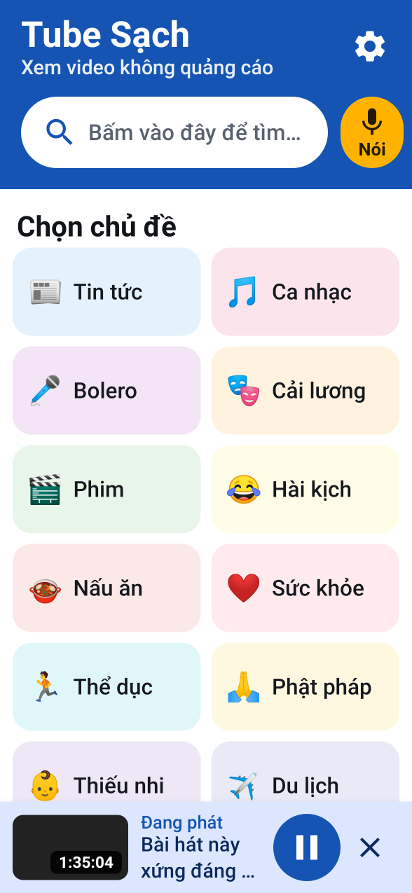

# Tube Sạch – xem YouTube không quảng cáo, dễ dùng cho người lớn tuổi

Ứng dụng Android để xem video YouTube:

- **Không có quảng cáo**: không quảng cáo đầu video, không quảng cáo giữa video, không banner.
- **Không cần đăng nhập**: không cần tài khoản Google, không cần MicroG.
- **Hình trong hình**: video thu thành cửa sổ nhỏ nổi trên màn hình để vừa xem vừa dùng Zalo, Facebook.
- **Tắt màn hình vẫn nghe được tiếng**: có nút điều khiển trên màn hình khoá, thanh thông báo, tai nghe Bluetooth.
- **Dễ dùng cho người lớn tuổi**: chữ to, nút to, có chữ ghi bên dưới mỗi nút, tìm bằng giọng nói, có sẵn các chủ đề (Tin tức, Ca nhạc, Bolero, Cải lương, Phim, Nấu ăn, Sức khoẻ…).

| Trang chủ | Kết quả tìm | Xem video | Đang phát + đi tìm video khác |
|---|---|---|---|
|  |  |  |  |

> Ảnh chụp được tạo tự động bằng Robolectric trên máy tính nên ảnh thu nhỏ của video để trống; trên điện thoại thật ảnh hiện bình thường.

## Tính năng

| Tính năng | Mô tả |
|---|---|
| Tìm kiếm | Ô tìm kiếm to, gợi ý khi gõ, lưu các lần tìm gần đây |
| Tìm bằng giọng nói | Bấm nút vàng **"Nói"** rồi nói tiếng Việt |
| Chủ đề có sẵn | 12 nút chủ đề, bấm là ra video |
| Xem tiếp | Mở lại video đã xem dở, phát tiếp từ chỗ đã dừng (hợp với video cải lương 2–3 tiếng) |
| Yêu thích | Bấm ❤ để lưu video |
| Hình trong hình | Nút **"Thu nhỏ màn hình"**, hoặc tự thu nhỏ khi bấm nút Home lúc đang xem (Android 8 trở lên) |
| Phát nền | Tắt màn hình hoặc chuyển ứng dụng khác vẫn nghe tiếng. Lúc này app chỉ tải tiếng nên đỡ tốn 3G/4G |
| Hẹn giờ tắt | 15 / 30 / 60 / 90 phút hoặc "khi hết video này" (dành cho người hay nghe rồi ngủ quên) |
| Tự phát tiếp | Hết video thì tự phát video liên quan (bật/tắt được) |
| Mở link từ Zalo/Facebook | Bấm **Chia sẻ → Tube Sạch** trên link YouTube người khác gửi |
| Chất lượng | 360p (tiết kiệm) / 480p / 720p (mặc định) / 1080p |
| Cỡ chữ | Lớn / Rất lớn / Cực lớn |
| Tự báo bản mới | Khi có bản sửa lỗi trên GitHub Releases, Trang chủ hiện thông báo màu vàng để bấm tải (chỉ chạy khi repo để công khai) |

## Cài đặt lên điện thoại

1. Vào mục **Releases** của repo này (hoặc **Actions → lần chạy mới nhất → Artifacts**), tải file `TubeSach-1.0.x.apk`.
2. Mở file vừa tải. Nếu điện thoại hỏi, bấm **Cài đặt → cho phép cài ứng dụng từ nguồn này**.
3. Bấm **Cài đặt**. Biểu tượng **Tube Sạch** (vòng tròn trắng nút play xanh) sẽ xuất hiện trên màn hình chính.

Yêu cầu: Android 6.0 trở lên. Hình trong hình cần Android 8.0 trở lên.

**Mẹo cho con cháu cài giúp ông bà:**

- Kéo biểu tượng Tube Sạch ra màn hình chính, để cạnh Zalo.
- Muốn link YouTube trong Zalo mở thẳng bằng Tube Sạch: *Cài đặt điện thoại → Ứng dụng → Tube Sạch → Mở theo mặc định → bật "Mở các liên kết được hỗ trợ"*. Nếu máy có app YouTube gốc thì nên tắt (vô hiệu hoá) nó đi để khỏi bị hỏi chọn app.
- Nếu xem lúc tắt màn hình bị ngắt tiếng (một số máy Xiaomi, Oppo, Vivo, Samsung tiết kiệm pin quá mạnh): *Cài đặt → Pin → Tube Sạch → Không giới hạn / Không tối ưu hoá*.

## Các app YouTube không quảng cáo hoạt động thế nào?

| App | Cách làm | Ghi chú |
|---|---|---|
| **YouTube Vanced** (đã dừng 2022) | Lấy APK YouTube gốc, dịch ngược rồi **sửa mã (patch smali)**: tắt đoạn mã tải quảng cáo, mở khoá phát nền và hình trong hình vốn là tính năng Premium | Đăng nhập Google qua **MicroG** (bản thay thế Google Play Services). Bị Google gửi thư yêu cầu dừng nên ngừng phát triển |
| **ReVanced** | Giống Vanced nhưng là một **bộ công cụ vá**: người dùng tự tải APK YouTube gốc rồi dùng *ReVanced Manager* áp các bản vá (chặn quảng cáo, SponsorBlock, phát nền…) ngay trên máy | Vẫn là app YouTube gốc nên giao diện y hệt; đăng nhập qua GmsCore/MicroG. YouTube cập nhật thì phải vá lại |
| **NewPipe, PipePipe, Tubular, LibreTube** | **Viết lại từ đầu**: đọc dữ liệu từ các API nội bộ của YouTube (InnerTube) hoặc qua máy chủ Piped/Invidious, lấy link file video gốc trên `googlevideo.com` rồi tự phát bằng ExoPlayer | Vì không dùng trình phát của YouTube nên **quảng cáo không bao giờ được tải**. Không cần tài khoản |
| **PureTube và các app "YouTube nền" trên Play** | Phần lớn là **WebView** (trình duyệt nhúng) mở trang `m.youtube.com`, chèn JavaScript/CSS để ẩn và bỏ qua quảng cáo, dùng dịch vụ nền (foreground service) để giữ tiếng khi tắt màn hình | Dễ làm nhưng thỉnh thoảng vẫn lọt quảng cáo |
| **Brave, Cốc Cốc, Kiwi + uBlock** | **Trình duyệt có bộ chặn quảng cáo** dùng danh sách lọc (EasyList, uBlock): chặn yêu cầu mạng tới máy chủ quảng cáo, ẩn phần tử quảng cáo, và chèn "scriptlet" xoá trường `adPlacements`/`playerAds` khỏi dữ liệu trình phát trước khi trang đọc tới. Phát nền bằng cách giả lập trang vẫn đang hiển thị (Page Visibility API) | Chặn DNS (AdGuard DNS, Pi-hole) **không chặn được** quảng cáo YouTube vì quảng cáo đến cùng máy chủ với video |

**Tube Sạch đi theo hướng của NewPipe** (cách ổn định và "sạch" nhất):

```
Tìm kiếm / thông tin video ──► NewPipeExtractor (đọc API InnerTube của YouTube, giống NewPipe)
                                    │
                                    ▼
          Link luồng hình (H.264 ≤ 720p) + luồng tiếng (AAC 128kbps) trên googlevideo.com
                                    │  bọc thành manifest DASH để tua nhanh
                                    ▼
              ExoPlayer (Media3) ── MediaSessionService: phát nền, màn hình khoá, Bluetooth
                                    │
                                    ▼
              Giao diện Jetpack Compose chữ to + chế độ Hình trong hình của Android
```

Không có bước nào gọi tới máy chủ quảng cáo nên không cần "chặn" gì cả.

## Khi YouTube thay đổi làm app không xem được

YouTube thỉnh thoảng đổi cách hoạt động khiến các app như NewPipe (và app này) tạm lỗi. Cách sửa:

1. Xem bản mới nhất của NewPipeExtractor tại <https://github.com/TeamNewPipe/NewPipeExtractor/releases>.
2. Sửa dòng sau trong `app/build.gradle.kts`:
   ```kotlin
   implementation("com.github.TeamNewPipe:NewPipeExtractor:v0.26.5")
   ```
   (Nếu bản sửa lỗi chưa phát hành, có thể dùng mã commit, ví dụ `:6cb36e9`.)
3. Push lên nhánh `main`. GitHub Actions tự build APK mới và tạo Release. Ứng dụng trên điện thoại sẽ hiện thông báo "Có phiên bản mới" nếu repo để công khai.

## Build từ mã nguồn

Cần JDK 17+ và Android SDK (compileSdk 36).

```bash
./gradlew :app:assembleRelease        # APK ở app/build/outputs/apk/release/
./gradlew :app:testDebugUnitTest      # test logic + test mở app (Robolectric)
```

Test cần mạng (gọi YouTube thật, kiểm tra ExoPlayer đọc được luồng hình + tiếng):

```bash
./gradlew :app:testDebugUnitTest -Donline=true --tests '*OnlinePipelineTest*'
```

Chụp lại ảnh màn hình (lưu ở `app/build/outputs/roborazzi/`):

```bash
./gradlew :app:testDebugUnitTest -Dscreenshots=true --tests '*ScreenshotTest*'
```

### Khoá ký APK

APK được ký bằng khoá cố định `app/signing/tubesach.jks` (mật khẩu `tubesach`) để các bản cập nhật cài đè được lên nhau. Khoá này nằm trong repo, ai có repo đều ký được APK giả mạo. Nếu repo để công khai hoặc chia sẻ rộng, nên tạo khoá riêng **trước khi** cài cho mọi người (đổi khoá thì phải gỡ app cũ rồi cài lại):

```bash
keytool -genkeypair -keystore my.jks -alias tubesach -keyalg RSA -keysize 2048 -validity 36500
base64 -w0 my.jks   # dán vào secret SIGNING_KEYSTORE_BASE64
```

Rồi thêm các secret `SIGNING_KEYSTORE_BASE64`, `SIGNING_STORE_PASSWORD`, `SIGNING_KEY_ALIAS`, `SIGNING_KEY_PASSWORD` trong *Settings → Secrets and variables → Actions*.

## Cấu trúc mã

```
app/src/main/java/com/luzart/tubesach/
├── App.kt                      Khởi tạo NewPipeExtractor, Coil, trình phát
├── net/OkHttpDownloader.kt     Bộ tải HTTP cho NewPipeExtractor
├── data/
│   ├── YouTubeRepository.kt    Tìm kiếm, gợi ý, thông tin video (ép tiếng Việt)
│   ├── LocalStore.kt           Lịch sử, yêu thích, cài đặt (chỉ lưu trên máy)
│   └── VideoItem.kt
├── player/
│   ├── StreamSourceFactory.kt  Chọn luồng hình/tiếng, dựng DASH, User-Agent theo máy khách
│   ├── PlaybackController.kt   Điều khiển phát, tự thử lại khi link hết hạn, hẹn giờ tắt, tự phát tiếp
│   └── PlaybackService.kt      MediaSessionService: phát nền + màn hình khoá
├── ui/
│   ├── MainActivity.kt         Hình trong hình, toàn màn hình, nhận link chia sẻ, giọng nói
│   ├── AppViewModel.kt         Điều hướng + trạng thái tìm kiếm
│   └── screens/…               Trang chủ, Tìm kiếm, Kết quả, Xem video, Cài đặt
└── update/UpdateChecker.kt     Kiểm tra bản mới trên GitHub Releases
```

## Lưu ý

- Ứng dụng dành cho mục đích cá nhân, học tập. Xem YouTube qua ứng dụng bên thứ ba không đúng Điều khoản dịch vụ của YouTube. Ứng dụng không tải lên hay phát tán lại nội dung nào.
- Nếu thích một kênh, hãy ủng hộ người làm video (đăng ký kênh, YouTube Premium…).
- Video giới hạn độ tuổi, video riêng tư và video chỉ dành cho hội viên không xem được vì cần đăng nhập.

## Giấy phép

GPL-3.0 (theo giấy phép của [NewPipeExtractor](https://github.com/TeamNewPipe/NewPipeExtractor)). Quy tắc R8/ProGuard và cách dựng nguồn phát tham khảo từ [NewPipe](https://github.com/TeamNewPipe/NewPipe).
