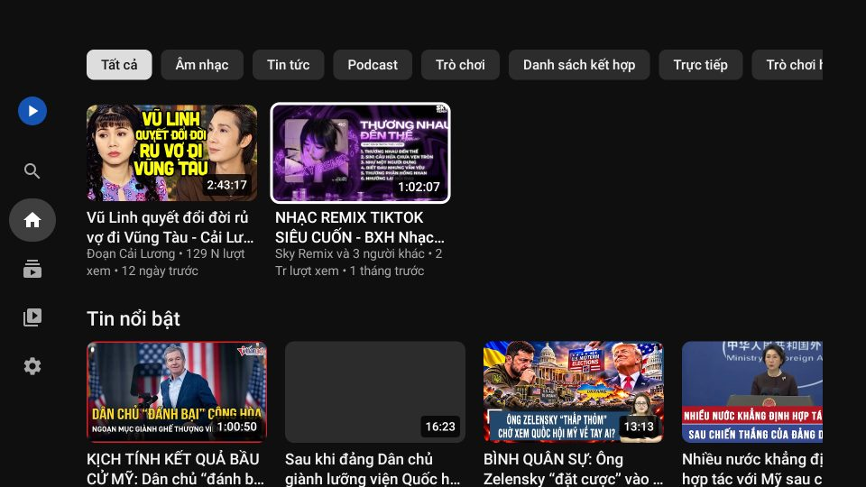

# Cài Tube Sạch TV lên TV Google TV (ví dụ Coocaa 55Y73)

Tube Sạch TV là app xem YouTube **không quảng cáo** dành cho TV. Bạn chọn video bằng các nút mũi tên trên remote, **không cần đăng nhập** tài khoản Google.

Dùng được trên TV chạy **Google TV** hoặc **Android TV**: Coocaa, TCL, Sony, Xiaomi, Casper, Toshiba…, cả các hộp TV Android và Chromecast with Google TV.



---

## Bạn cần chuẩn bị

1. File cài đặt **`TubeSachTV.apk`**. Có thể lấy ở một trong các nơi sau:
   - file được gửi kèm trong cuộc trò chuyện với Claude;
   - mục **Actions** của repo GitHub → lần chạy mới nhất → **Artifacts** → `TubeSachTV-…` (tải về được file .zip, giải nén ra file .apk);
   - mục **Releases** của repo → file `TubeSachTV-2.0.x.apk`.
2. TV và điện thoại dùng **chung một mạng Wi‑Fi** (nếu làm theo cách 1).

> Cài app ngoài cửa hàng Google Play gọi là "cài thủ công". Cách này an toàn với file do chính bạn build. Nó không làm mất bảo hành TV và không cần "root".

---

## Bước 1 – Bật "Chế độ nhà phát triển" trên TV (làm một lần)

Trên Google TV, phải bật chế độ này thì mới thấy mục cho phép cài app ngoài.

1. Bấm nút **⚙ Cài đặt** trên remote. Hoặc chọn biểu tượng ⚙ ở góc trên bên phải màn hình chính.
2. Chọn **Hệ thống** → **Giới thiệu**.
   (Tiếng Anh: *System → About*)
3. Kéo xuống mục **Bản dựng hệ điều hành Android TV** (*Android TV OS build*).
4. Bấm nút **OK** ở giữa remote **7 lần liên tiếp**.
5. TV báo **"Bạn hiện đã là nhà phát triển!"** là xong. Bấm **Quay lại** để thoát.

---

## Bước 2 – Đưa file APK lên TV

Chọn **một** trong các cách dưới. **Cách 1** dễ nhất nếu bạn có điện thoại Android.

### Cách 1: Gửi từ điện thoại qua Wi‑Fi (không cần dây)

1. **Trên TV:** mở **Google Play** → tìm **"Send files to TV"** → **Cài đặt**.
2. **Trên điện thoại:** mở **CH Play** → tìm **"Send files to TV"** → **Cài đặt**.
3. **Trên điện thoại:** tải file `TubeSachTV.apk` về máy (xem phần "Bạn cần chuẩn bị").
4. **Trên TV:** mở app **Send files to TV** → chọn **Receive** (Nhận). Cho phép app truy cập bộ nhớ nếu TV hỏi.
5. **Trên điện thoại:** mở app **Send files to TV** → chọn **Send** (Gửi) → chọn file `TubeSachTV.apk` trong thư mục *Download* → chọn tên TV của bạn.
6. Chờ gửi xong (khoảng 4 MB, vài giây).
7. **Trên TV:** trong app Send files to TV, chọn **Files** → thư mục **Download** → chọn **TubeSachTV.apk**, rồi chuyển sang **Bước 3**.

### Cách 2: Dùng USB

1. Chép file `TubeSachTV.apk` vào một chiếc USB bằng máy tính.
2. Cắm USB vào cổng USB ở cạnh hoặc sau TV.
3. **Trên TV:** mở **Google Play** → tìm **"File Commander"** (hoặc "X‑plore File Manager") → **Cài đặt**.
4. Mở **File Commander** → chọn ổ **USB** → chọn **TubeSachTV.apk**, rồi chuyển sang **Bước 3**.

### Cách 3: Tải thẳng trên TV bằng app Downloader (chỉ dùng được khi repo GitHub để **công khai**)

1. **Trên TV:** mở **Google Play** → tìm **"Downloader"** (biểu tượng màu cam, của AFTVnews) → **Cài đặt**.
2. Mở Downloader, gõ địa chỉ dưới đây vào ô nhập rồi bấm **Go**:
   ```
   https://github.com/luzart-otherthing/youtube-remove-ads/releases/latest/download/TubeSachTV.apk
   ```
3. Tải xong, Downloader tự hỏi cài đặt. Chuyển sang **Bước 3**.

### Cách 4: Dùng máy tính (cho người rành máy tính)

1. Trên TV vào **Cài đặt → Hệ thống → Tuỳ chọn cho nhà phát triển**, bật **Gỡ lỗi USB** (*USB debugging*) hoặc **Gỡ lỗi qua mạng** (*Network debugging*).
2. Xem địa chỉ IP của TV trong **Cài đặt → Mạng và Internet → (tên Wi‑Fi)**.
3. Trên máy tính đã cài [Android platform‑tools](https://developer.android.com/tools/releases/platform-tools), chạy lần lượt:

   ```bash
   adb connect 192.168.1.50:5555
   ```

   ```bash
   adb install -r TubeSachTV.apk
   ```

   Thay `192.168.1.50` bằng IP của TV. Lần đầu kết nối, TV hỏi "Cho phép gỡ lỗi?": chọn **Cho phép**.

---

## Bước 3 – Cài đặt

1. Khi chọn file `TubeSachTV.apk`, lần đầu TV sẽ báo **"TV của bạn không được phép cài đặt ứng dụng không rõ nguồn gốc từ nguồn này"**. Chọn **Cài đặt** (*Settings*) trong thông báo đó.
   - Nếu không có nút đó, tự vào: **Cài đặt → Ứng dụng → Bảo mật và quyền hạn chế → Nguồn không xác định**
     (*Settings → Apps → Security & restrictions → Unknown sources*).
   - Ở một số bản Google TV mới, mục này nằm ở: **Cài đặt → Ứng dụng → Quyền truy cập đặc biệt của ứng dụng → Cài đặt ứng dụng không rõ nguồn gốc**
     (*Special app access → Install unknown apps*).
2. **Bật** cho app bạn đang dùng để mở file (*Send files to TV*, *File Commander* hoặc *Downloader*).
3. Bấm **Quay lại**, chọn lại file APK → **Cài đặt** (*Install*).
4. Nếu **Google Play Protect** cảnh báo "Ứng dụng chưa được xác minh", chọn **Thêm chi tiết** → **Vẫn cài đặt** (*Install anyway*). Cảnh báo này hiện với mọi app không có trên Google Play.
5. Cài xong, chọn **Mở**.

## Bước 4 – Đưa app ra màn hình chính

1. Ở màn hình chính của Google TV, vào hàng **Ứng dụng** (*Apps*) → **Xem tất cả**.
2. Tìm **Tube Sạch TV** (biểu tượng xanh có nút ▶ trắng).
3. **Giữ nút OK** trên biểu tượng → **Thêm vào mục yêu thích** (*Add to favorites*). Hoặc chọn **Di chuyển** để đưa lên đầu.

Sau khi cài xong có thể gỡ *Send files to TV* / *File Commander* / *Downloader* nếu không dùng nữa.

---

## Cách dùng bằng remote

| Ở đâu | Nút | Tác dụng |
|---|---|---|
| Khắp nơi | ◀ ▶ ▲ ▼ | Chọn (ô đang chọn có viền trắng, phóng to) |
| | **OK** | Mở |
| | **Giữ OK** trên một video | Menu: *Lưu vào Xem sau*, *Đi đến kênh*, *Phát từ đầu*, *Không quan tâm* |
| | **Quay lại** | Về thanh bên trái → về Trang chủ → bấm thêm lần nữa để thoát |
| Thanh bên trái | 🔍 🏠 📺 📚 ⚙ | Tìm kiếm · Trang chủ · Kênh đăng ký · Thư viện (đã xem, xem sau, đã thích) · Cài đặt |
| **Đang xem video** | **OK** | Tạm dừng / phát tiếp |
| | ◀ ▶ | Lùi / tua 10 giây. **Giữ** để tua nhanh (30 giây, 1 phút) |
| | ▲ hoặc ▼ | Hiện thanh điều khiển |
| | ▼ (khi đang hiện điều khiển) | Xem hàng **Video tiếp theo** |
| | **Quay lại** | Ẩn thanh điều khiển → thoát video |
| | ⏯ ⏪ ⏩ ⏭ (nếu remote có) | Dùng được luôn |

Các nút trên thanh điều khiển (chọn nút nào thì có chữ giải thích hiện bên dưới):

⏮ Video trước · ↺10 Lùi 10 giây · ▶ Phát/Tạm dừng · ↻10 Tua 10 giây · ⏭ Video tiếp theo · **CC** Phụ đề (có *Tự động dịch: Tiếng Việt*) · **HQ** Chất lượng · ⏱ Tốc độ phát · **$** Bật/tắt SponsorBlock · 👍 Thích · 🕒 Xem sau · 🌙 **Hẹn giờ tắt** (15 phút … 2 giờ, hoặc khi hết video) · ⓘ Thông tin video, **Đăng ký kênh**.

**Tìm kiếm:** vào 🔍 → bấm **OK** vào ô tìm kiếm để hiện bàn phím của TV. Hoặc chọn nút **micro** trên màn hình để nói.

---

## Câu hỏi thường gặp

**Bấm nút YouTube trên remote có mở Tube Sạch TV không?**
Không. Nút đó do hãng TV cài sẵn để mở app YouTube gốc. Hãy mở Tube Sạch TV từ màn hình chính (Bước 4).

**Có xem được 2K, 4K không?**
Có, nếu video được đăng ở độ nét đó. YouTube chỉ có 2K / 4K / 8K ở dạng mã hoá **VP9**. Khi mở, app kiểm tra chip giải mã của TV rồi phát tới mức cao nhất mà chip làm được bằng phần cứng.
- TV 4K như Coocaa 55Y73: tới **2160p (4K)**.
- TV không có chip phù hợp: tự dùng H.264 1080p cho mượt.

Xem TV của bạn được tới đâu ở *Cài đặt → Độ nét tối đa TV phát được*.
- **Tự động** (mặc định): chọn mức nét nhất mà mạng chạy mượt. 4K cần mạng khoảng 25 Mbps trở lên; nếu TV nối dây mạng LAN thì càng ổn định.
- **Cao nhất có thể**: luôn phát nét nhất.
- Hoặc chọn hẳn một mức, ví dụ **2160p (4K)**.

Khi xem, chọn nút **HQ** sẽ thấy dòng "đang phát 2160p (4K)". Video HDR được phát ở chế độ thường (SDR) để màu đúng trên mọi TV.

**Có cần đăng nhập không? Có đề xuất video không?**
Không cần đăng nhập. Lần đầu mở app, trang chủ hiện *Thịnh hành tại Việt Nam*. Sau khi xem vài video, YouTube sẽ đề xuất theo những gì bạn đã xem (ẩn danh). Tắt được trong Cài đặt.

**Kênh đăng ký, lịch sử có đồng bộ với điện thoại không?**
Không. TV và điện thoại lưu riêng. Không có tài khoản nên không gửi dữ liệu đi đâu.

**Video giới hạn độ tuổi, video riêng tư, video hội viên không xem được?**
Đúng vậy, vì những video đó cần đăng nhập.

**App báo lỗi / không phát được?**
YouTube thỉnh thoảng thay đổi cách hoạt động. Bấm **Thử lại** trước. Nếu vẫn lỗi, cài bản mới nhất: cài đè lên bản cũ, không mất lịch sử. Nếu repo GitHub để công khai, app tự báo khi có bản mới, tự tải và cài ngay trên TV.

**Sau này Google có chặn cài app ngoài không?**
Google bắt đầu yêu cầu "xác minh nhà phát triển" với app cài ngoài Google Play. Từ 30/9/2026 áp dụng ở Brazil, Indonesia, Singapore, Thái Lan; dự kiến áp dụng toàn cầu từ 2027. Việt Nam chưa nằm trong đợt đầu. Khi bị áp dụng, cài bằng máy tính (**Cách 4**, `adb install`) vẫn được phép. Google cũng có một cách cài nâng cao cho người dùng rành máy.

**Cài bản mới bị báo "Ứng dụng chưa được cài đặt"?**
Thường do bản cũ được ký bằng khoá khác (ví dụ đã đổi khoá ký trong GitHub Secrets). Gỡ bản cũ (*Cài đặt → Ứng dụng → Tube Sạch TV → Gỡ cài đặt*) rồi cài lại.

---

*Dùng cho mục đích cá nhân. Xem YouTube qua ứng dụng bên thứ ba không đúng Điều khoản dịch vụ của YouTube. App không liên kết với YouTube hay Google.*
