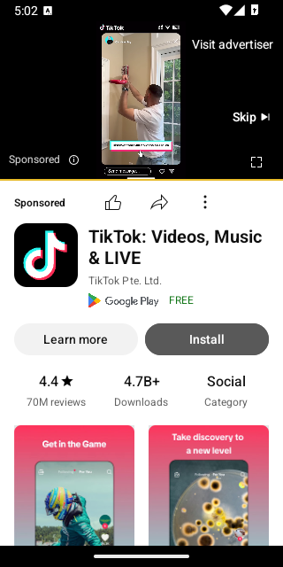
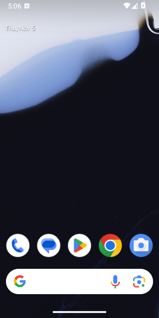
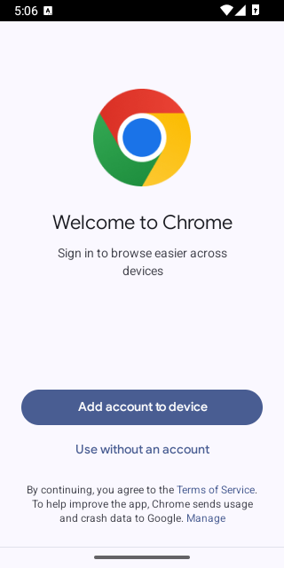

# Thử nghiệm riêng: ReVanced có chặn quảng cáo tốt hơn cách InnerTube của Tube Sạch không?

> Thư mục này **không liên quan** tới app Tube Sạch: không sửa dòng nào trong `app/`, không nằm trong bản dựng APK của app.
> Chỉ có công cụ đo, workflow thử ReVanced và báo cáo này.

## Trả lời ngắn

1. **Về chặn quảng cáo: ReVanced không tốt hơn.** Tube Sạch không có quảng cáo ngay từ cách làm. App chỉ đọc đúng những loại mục nó biết (video, Shorts, kênh) và bỏ qua mọi thứ khác, nên quảng cáo không bao giờ được tải. ReVanced phải gỡ quảng cáo ra khỏi app YouTube, vốn được làm ra để hiện quảng cáo. Nó dùng danh sách khoảng 40 mẫu tên quảng cáo và phải cập nhật mỗi khi YouTube đổi giao diện.
2. **Cách lấy video thì giống hệt nhau.** Bản vá "Spoof video streams" của ReVanced lấy link phát bằng các máy khách `VISIONOS`, `ANDROID_VR`, `ANDROID_REEL`. `VISIONOS` cũng chính là máy khách Tube Sạch đang dùng. Khi YouTube chặn mẹo này, cả hai cùng hỏng.
3. **ReVanced không cần microG và không cần root: không chạy được.** Đã thử thật trên giả lập Android 15 có Google Play:
   - App ReVanced tên gói riêng, trỏ thẳng vào Google Play Services thật, bị **chính Google Play Services từ chối**: `GoogleCertificatesRslt: not allowed`, vì app không có chữ ký Google.
   - YouTube sau đó **tự đóng** (`Failed to fetch kids onboarding status, finishing the App`) rồi văng, cả khi mở lại lần 2.
   - ReVanced bản thường thì mở trang tải GmsCore (microG) rồi thoát.

   Đúng là có thể làm "một app riêng" để cài song song YouTube gốc, nhưng app riêng đó cần **microG thay chỗ Google Play Services**. Không muốn microG thì chỉ còn cách **root** máy và gắn (mount) bản vá đè lên YouTube gốc.

**Khuyến nghị:** giữ cách InnerTube của Tube Sạch (xem mục 6).

## 1. ReVanced chặn quảng cáo thế nào (đọc mã nguồn)

Mã ReVanced hiện ở GitLab ([gitlab.com/ReVanced/revanced-patches](https://gitlab.com/ReVanced/revanced-patches)), vì repo GitHub không còn (404). Bộ vá dùng ở đây là v6.2.1 (ngày 02/06/2026), hỗ trợ YouTube tới 20.40.45.

| Bản vá | Cách làm |
|---|---|
| **Video ads** | Chèn `return` vào đầu hàm tải quảng cáo video của app YouTube. Quảng cáo trước/giữa video không được tải. |
| **Hide ads** | Bộ lọc "litho": so tên thành phần giao diện với khoảng 40 mẫu (`ads_video_with_context`, `full_width_square_image_layout`, `statement_banner`, `product_carousel`…). Ngoài ra còn tự đóng hộp thoại quảng cáo toàn màn hình, ẩn view `ad_attribution` và ẩn banner Premium. |
| **Hide ads** (mẹo phía máy chủ) | Khi app gọi trang chủ và tìm kiếm, khai `osName = "Android Automotive"` (giả làm màn hình ô tô) để YouTube gửi ít quảng cáo hơn. |
| **Spoof video streams** | Lấy link phát bằng máy khách khác (`ANDROID_REEL`, `ANDROID_VR`, `VISIONOS`, `ANDROID_CREATOR`) vì máy khách Android thật cần chứng thực của Google Play. |
| **GmsCore support** | Đổi tên gói thành `app.revanced.android.youtube` để cài song song YouTube gốc mà không cần root. Mọi lời gọi Google Play Services được chuyển sang GmsCore (= microG) của ReVanced. |

Cả hai nhánh của ReVanced đều cần microG khi không root:
- **ReVanced chính thức:** nếu không thấy GmsCore, app hiện thông báo, mở trang tải GmsCore rồi **tự thoát** (`GmsCoreSupport.checkInstallation` → `System.exit(0)`).
- **Morphe** (nhánh tách ra năm 2026, theo mã nguồn): cũng thoát như vậy, và còn không có tuỳ chọn đổi nơi gọi.

## 2. Tube Sạch chặn quảng cáo thế nào

- `innertube/Parser.kt` chỉ đọc `videoRenderer`, `lockupViewModel`, `shortsLockupViewModel`, `reelItemRenderer`, `channelRenderer`… Quảng cáo YouTube luôn gói trong `adSlotRenderer`, `searchPyvRenderer`, `promotedVideoRenderer`… nên bị bỏ qua mà không cần biết tên.
- `innertube/DirectStreams.kt` chỉ lấy `streamingData`. Các mục `adPlacements`, `playerAds`, `adBreakHeartbeatParams` trong phản hồi `/player` không bao giờ được dùng, nên quảng cáo video không được tải.
- Tài trợ do chính người làm video nói trong video thì không có cách nào "chặn". Tube Sạch dùng SponsorBlock, giống ReVanced.

## 3. Kết quả đo (`experiments/ad-audit`)

Công cụ đo là dự án Gradle riêng. Nó biên dịch **đúng** `InnerTube.kt`, `Parser.kt`, `DirectStreams.kt` của app (chỉ chép sang, không sửa), rồi gọi YouTube thật bằng tiếng Việt, khu vực VN, khách ẩn danh. Kết quả đầy đủ: [`ad-audit/ket-qua.md`](ad-audit/ket-qua.md).

| Đo gì | Kết quả |
|---|---|
| 18 trang (trang chủ, thịnh hành, top nhạc, 10 từ khoá dễ có quảng cáo, 5 trang xem) | YouTube gửi 5 khối quảng cáo (`adsEngagementPanelContentRenderer` ở trang xem). **Lọt ra màn hình Tube Sạch: 0.** |
| `/player` bằng visionOS (Tube Sạch) | Có `adBreakHeartbeatParams` (quảng cáo được gửi kèm), Tube Sạch không dùng. Độ dài luồng **bằng** độ dài video, nên **không có quảng cáo chèn thẳng vào luồng** (SSAI). |
| Mẫu quảng cáo dựng sẵn đúng hình dạng YouTube (adSlotRenderer, searchPyvRenderer, promotedVideoRenderer, compactPromotedVideoRenderer, banner Premium) | **Lọt: 0** |
| Trường hợp giả định: quảng cáo **giả làm video thường**, chỉ có nhãn "Được tài trợ" | **Lọt: 1.** Tube Sạch hiện tại không kiểm nhãn. YouTube hiện chưa làm vậy, và bộ lọc của ReVanced (theo tên thành phần) cũng không bắt được kiểu này. |
| Máy khách ANDROID (thứ app YouTube thật nhận) và mẹo "Android Automotive" | Từ máy đo, YouTube không gửi quảng cáo danh sách cho cả hai, nên không thấy khác biệt. |

Giới hạn: lượng quảng cáo YouTube gửi phụ thuộc IP, khu vực và lịch sử xem. Máy đo là máy chủ ở nước ngoài, nên YouTube gửi rất ít quảng cáo danh sách. Vì thế có thêm phần thử bằng mẫu dựng sẵn.

## 4. Thử ReVanced không microG (`experiments/revanced`, workflow "Thử ReVanced không microG")

GitHub Actions tự làm các bước sau:
1. Tải ReVanced CLI 6.0.0 (GitHub) và bộ vá v6.2.1 (`api.revanced.app`), **kiểm tra chữ ký PGP** của bộ vá bằng `gpg`, sai thì dừng. Khoá ký: `A783 5DFC ACA1 4BDA 3CD6 EDD3 633C 6920 FBE6 A2FF`, "ReVanced <contact@revanced.app>". Khoá này lấy từ `api.revanced.app`, cùng nguồn ReVanced Manager dùng.
2. Tải YouTube 20.40.45 bản gốc trên APKMirror, **kiểm tra chữ ký Google**: khoá `3d7a1223…994a` phải nằm trong danh sách người ký.
3. Vá thành 2 bản:
   - `youtube-revanced-khong-microg.apk`: tên gói riêng, tuỳ chọn "GmsCore vendor group ID" = `com.google`, tức mọi lời gọi đi vào Google Play Services thật. Bước kiểm tra trong mã (dex) xác nhận còn **0** chỗ gọi `app.revanced.android.gms` (bản chuẩn có 16).
   - `youtube-revanced-chuan.apk`: ReVanced như mọi người vẫn cài (cần GmsCore/microG), dùng để đối chứng.
4. Chạy giả lập Android 15 có Google Play (Google Play Services 24.23.35), **không có microG**. Cài lần lượt 3 bản, mở cùng một video (`dQw4w9WgXcQ`), chờ 60 giây. Ghi lại: app còn chạy không, có văng không, có đang phát không, chữ trên màn hình, ảnh chụp. Nếu không phát được thì mở lại lần 2.

### Kết quả

| Bản | Kết quả trên giả lập |
|---|---|
| **YouTube gốc** (đối chứng) | Phát video bình thường **và hiện quảng cáo** ở cả 4 lượt chạy: quảng cáo trước video ("Sponsored", "Skip ad", "Visit advertiser", ví dụ quảng cáo TikTok) và banner quảng cáo dưới video ("Sponsored – …", "Stop ads"). |
| **ReVanced không microG** (trỏ vào Google Play Services thật) | **Không phát được, văng cả lần mở đầu lẫn lần mở lại.** Google Play Services từ chối app: `GoogleCertificatesRslt: not allowed: pkg=app.revanced.android.youtube` và `PackageVerificationRslt: not allowed`. YouTube ghi `Failed to fetch kids onboarding status, finishing the App` rồi tự đóng. Sau đó luồng **DG (DroidGuard**, dịch vụ chứng thực của Google mà YouTube dùng) văng vì `SecurityException: PackageVerificationRslt: not allowed`. Màn hình quay về màn hình chính. |
| **ReVanced chuẩn** (cần microG) | Báo thiếu GmsCore, mở trang tải `github.com/revanced/gmscore` trong Chrome rồi thoát. Mở lại thì vẫn vậy. |

Bằng chứng (ảnh chụp, log, bảng tóm tắt đầy đủ) ở [`revanced/ket-qua/`](revanced/ket-qua/):

| YouTube gốc: quảng cáo trước video | ReVanced không microG: văng về màn hình chính | ReVanced chuẩn: mở trang tải GmsCore |
|---|---|---|
|  |  |  |

Các dòng log quyết định: [`revanced/ket-qua/log-quan-trong.txt`](revanced/ket-qua/log-quan-trong.txt).

Vì sao microG làm được còn Google Play Services thật thì không: app đã vá mang chữ ký khác chữ ký Google. Google Play Services thật kiểm tra chữ ký và từ chối. microG (GmsCore) đọc chữ ký "giả" mà bản vá ghi vào app (`SPOOFED_PACKAGE_SIGNATURE`) và chấp nhận. Máy không root không có cách nào khác để qua bước này. Với root, có thể gắn bản vá đè lên YouTube gốc: hệ thống vẫn thấy chữ ký Google nên không cần microG.

Những trục trặc gặp khi dựng (ghi lại cho lần sau):
- APK YouTube gốc (APKMirror; file `-all.apk` trên archive.org trùng kích thước) mang **nhiều chữ ký** vì YouTube đã đổi khoá (APK Signature Scheme v3.1). Dòng chứng chỉ đầu tiên là khoá mới (`5aad2bee…`), nên phải kiểm tra "có khoá Google `3d7a1223…` trong danh sách" chứ không chỉ đọc dòng đầu.
- ReVanced CLI v6 đòi chữ ký PGP và chứng thực build GitHub của bộ vá. Repo GitHub không còn nên không có chứng thực; chữ ký PGP được kiểm bằng `gpg` trước, rồi CLI chạy với `-b`.
- ReVanced Patcher v22 tra tuỳ chọn theo **tên** (`"GmsCore vendor group ID"`), không theo khoá cũ `gmsCoreVendorGroupId`. Tuỳ chọn phải đặt **sau** `--ei <chỉ số>` của đúng bản vá YouTube, vì nhiều app có bản vá trùng tên "GmsCore support".

## 5. So sánh

| | Tube Sạch (InnerTube) | ReVanced + microG | ReVanced không microG |
|---|---|---|---|
| Chặn quảng cáo | Không tải quảng cáo (danh sách trắng) | Gỡ quảng cáo khỏi app YouTube (danh sách đen, phải cập nhật) | — |
| Lấy link video | visionOS (+ NewPipe dự phòng) | VISIONOS / ANDROID_VR / ANDROID_REEL | — |
| Cần microG | Không | **Có** | Không |
| Cần root | Không | Không | **Có**, nếu muốn chạy được |
| Chạy được trên máy thường | Có | Có | **Không** (Google Play Services từ chối, app tự đóng và văng) |
| Đăng nhập Google | Không | Có (qua microG) | — |
| Khi YouTube đổi | Sửa `Parser.kt` | Chờ ReVanced ra bản vá **và** tự vá lại APK | — |
| Giao diện | Làm riêng, chữ to cho người lớn tuổi | Giao diện YouTube thật | — |
| Cập nhật cho người dùng | App tự kiểm tra bản mới | Phải vá lại mỗi lần đổi bản YouTube | — |

## 6. Khuyến nghị

1. **Giữ cách InnerTube của Tube Sạch.** Với yêu cầu "không microG, không root", ReVanced không dùng được. Nếu có microG thì nó cũng không chặn quảng cáo tốt hơn, lại phải vá lại mỗi khi YouTube cập nhật, một việc người lớn tuổi không tự làm được.
2. **Hai điều có thể học từ ReVanced cho Tube Sạch** (chỉ là đề xuất, chưa sửa app):
   - Bỏ qua mục có nhãn "Được tài trợ"/"Quảng cáo" trong `Parser.kt`, để bịt trường hợp giả định ở mục 3. Chỉ khoảng 10 dòng.
   - Thêm `ANDROID_VR` làm máy khách lấy link dự phòng giữa visionOS và NewPipe, giống chuỗi dự phòng của ReVanced.
3. Nếu sau này thật sự muốn **giao diện YouTube thật**: chỉ có ReVanced + microG (không root), hoặc root rồi gắn đè lên YouTube gốc. Không có đường thứ ba.

## Chạy lại

```bash
# Công cụ đo quảng cáo (cần mạng; ghi kết quả vào experiments/ad-audit/ket-qua.md)
./gradlew -p experiments/ad-audit run --args="experiments/ad-audit/ket-qua.md"
```

Workflow ReVanced chạy trên GitHub Actions: *Actions → Thử ReVanced không microG → Run workflow* (có thể đổi mã video). Ảnh chụp, logcat và `tom-tat.md` nằm trong artifact `ket-qua-gia-lap` của lần chạy; các APK nằm trong artifact `revanced-apks` (chỉ để thử, **không nên cài cho người dùng**).
